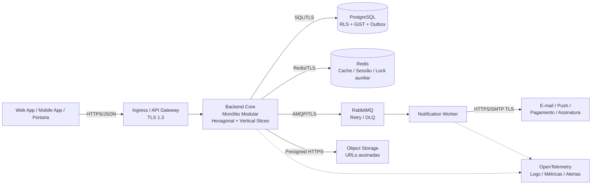

# Documento de Arquitetura da Solução (DAS)

## Sistema SaaS Multi-tenant de Gestão Condominial

| Campo | Valor |
|---|---|
| Versão | 1.0 — Checkpoint 2 |
| Status | Em consolidação arquitetural |
| Data de referência | 2026-10-15 |
| Documento de negócio de origem | [Checkpoint 1](../checkpoint_1/README.md) |
| Público | Arquitetura, desenvolvimento, operações, segurança, qualidade e governança |

## Equipe do Projeto

| Integrante | RM |
|---|---:|
| Ana Carolina Pereira Lopez | 568401 |
| Danilo Roberto Anterio dos Santos | 566966 |
| Enzo Hitoshi Oda | 567313 |
| Henrique Fessel Trench | 567513 |
| José Ribeiro dos Santos Neto | 567692 |

## Propósito e regra de leitura

Este é o índice mestre do DAS. As decisões técnicas detalhadas permanecem nos documentos temáticos referenciados abaixo para evitar duplicação e manter uma única fonte de verdade. O DAS traduz os requisitos aprovados no Checkpoint 1 em arquitetura verificável; não redefine objetivos, escopo, processos As-Is/To-Be, User Stories ou RNFs.

Os requisitos devem ser referenciados com seus IDs originais (`US01`–`US13` e `RNF-*`). A matriz ponta a ponta estará no Anexo C.

## Índice do DAS

| Seções | Conteúdo | Documento |
|---|---|---|
| 2–4 | Introdução, referências de negócio, direcionadores, RAS e critérios de aceite arquitetural | [01 — Fundamentos e Direcionadores](docs/01-fundamentos-e-direcionadores/direcionadores-e-ras.md) |
| 5–8 | Integrações, princípios, estilo, C4 Contexto e C4 Containers | [02 — Arquitetura C4](docs/02-arquitetura-c4/estilo-e-diagramas-c4.md) |
| 9–10 | C4 Componentes/Código, sequências, GoF, DDD e persistência | [03 — Interações, Padrões e Domínio](docs/03-interacoes-padroes-e-dominio/sequencia-gof-ddd.md) |
| 11 | Registros de decisão arquitetural e refatoração dirigida por padrões | [04 — ADRs](docs/04-adrs/catalogo-adrs.md) |
| 12–22 | Segurança, observabilidade, cache, filas, resiliência, DevSecOps, Kubernetes, SRE e Go Live | [05 — Segurança, Operação e SRE](docs/05-seguranca-operacao-sre/seguranca-k8s-confiabilidade.md) |
| 24 e Anexos A–L | APIs, eventos, rastreabilidade, DDL, RBAC, normas técnicas, capacidade, backup e checklists | [06 — Anexos e Checklists](docs/06-anexos-e-checklists/anexos-a-ate-l.md) |

## Referência arquitetural consolidada

### Decisões estruturantes

- **Dados:** PostgreSQL é fonte transacional de verdade; `condominium_id` e RLS implementam isolamento; `EXCLUDE USING gist` protege reservas concorrentes; históricos críticos são append-only.
- **Aplicação:** Backend Core stateless com nove módulos de domínio, portas/adaptadores e vertical slices; autorização ocorre no backend e é reforçada no banco.
- **Operação:** Redis é otimização e sessão/revogação, nunca fonte única de negócio; RabbitMQ, Outbox, retry e DLQ isolam efeitos assíncronos.
- **Infraestrutura:** Kubernetes executa API, frontend, relay e worker com Ingress, HPA/KEDA, PDB, NetworkPolicies e observabilidade OpenTelemetry.

## Governança de alteração

Uma mudança que afete invariantes de dados, fronteiras de módulo, integração externa, SLO, RTO/RPO, segurança, privacidade ou mecanismo de resiliência deve:

1. atualizar o ADR aplicável ou criar um novo;
2. manter/atualizar a rastreabilidade no Anexo C;
3. acrescentar critérios de aceite e evidência automatizada;
4. ser revisada por arquitetura, segurança e operações quando aplicável;
5. atualizar o checklist de revisão do DAS.