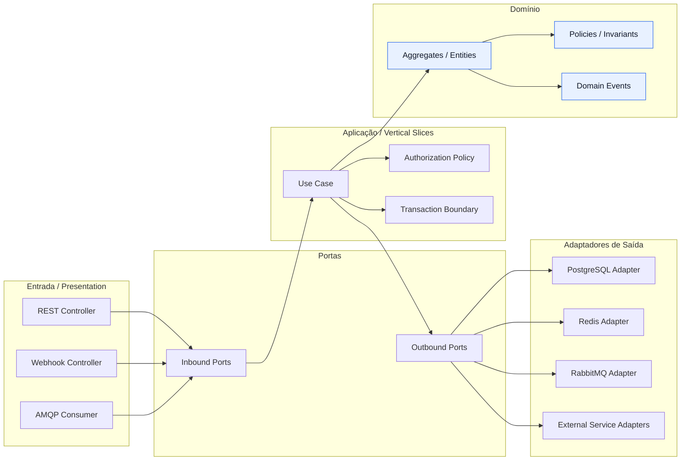
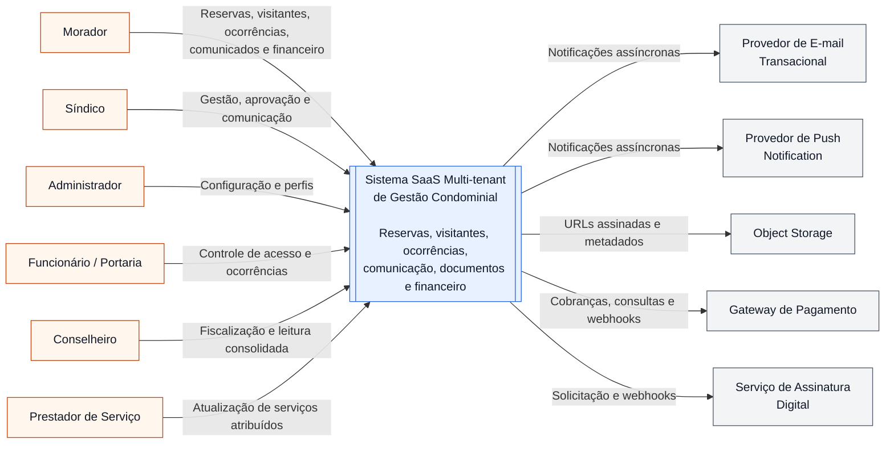
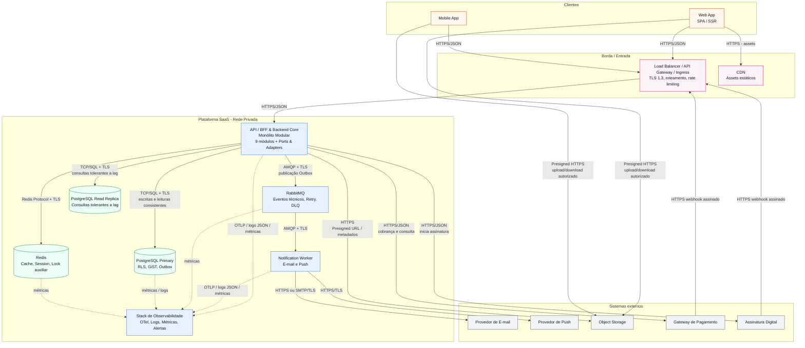

# 5. Catálogo de Integrações

As integrações externas permanecem encapsuladas por portas de saída do domínio. Nenhum módulo de negócio conhece SDK, modelo de autenticação, URL ou semântica específica de fornecedor. Adaptadores implementam as interfaces internas, permitindo homologação por contrato, substituição de provedor e aplicação uniforme de telemetria, timeout, retry e idempotência.

| Sistema / Serviço Externo | Tecnologia / Protocolo | Padrão de comunicação (síncrono/assíncrono) | Porta interna no domínio (interface) | Objetivo de negócio (US/RNF relacionados) | Controles de resiliência, segurança e idempotência |
|---|---|---|---|---|---|
| Provedor de E-mail Transacional | REST/JSON autenticado por API key, ou SMTP sobre TLS | Assíncrono: `Notification Worker` consome evento do RabbitMQ e envia a mensagem | `EmailSender` | Confirmação e cancelamento de reserva (`US01`, `US02`), mudança de ocorrência (`US07`), comunicados (`US09`); `RNF-PERF-03`, `RNF-DISP-03`, `RNF-ESC-03` | Credenciais em Secrets Manager; timeout explícito; retry com backoff exponencial e jitter somente para falhas transitórias; chave de idempotência por evento/canal/destinatário; DLQ após esgotamento; logs sem conteúdo sensível; métricas de entrega, erro e idade da fila. |
| Provedor de Push Notification | REST/JSON sobre HTTPS/TLS; credenciais de aplicação e tokens de dispositivo | Assíncrono: `Notification Worker` consome evento do RabbitMQ | `PushSender` | Alertas de visitante, comunicado segmentado e atualização de ocorrência; `US04`, `US07`, `US09`; `RNF-PERF-03`, `RNF-DISP-03`, `RNF-ESC-03` | Tokens de dispositivo criptografados em repouso; tokens inválidos revogados; timeout, circuit breaker e retry com backoff; idempotência por evento/dispositivo; DLQ; não bloqueia operações de reserva, visitante ou ocorrência. |
| Object Storage | API compatível com S3 sobre HTTPS/TLS; URLs pré-assinadas para upload/download | Síncrono somente para emissão de URL e metadados; transferência de arquivo direta entre cliente e storage | `FileStorage` | Repositório de atas, convenção, contratos, prestação de contas e imagens; `US11`; `RNF-PERF-01`, `RNF-SEG-09`, `RNF-SEG-10` | O backend autoriza antes de gerar URL pré-assinada; escopo de objeto, método e expiração curta; criptografia AES-256 em repouso; TLS 1.3 em trânsito; prefixo por tenant; validação de tipo/tamanho; varredura antimalware antes de publicação; sem credencial permanente no cliente. |
| Gateway de Pagamento | REST/JSON sobre HTTPS/TLS; webhooks assinados | Síncrono para criação/consulta de cobrança; assíncrono para confirmação por webhook | `PaymentGateway` | Situação de pagamento da unidade e atualização de lançamento financeiro; `US12`, `US13`; `RNF-SEG-09`, `RNF-SEG-10`, `RNF-MANT-01` | Assinatura HMAC ou assimétrica do webhook validada com timestamp e proteção contra replay; idempotência por `provider_event_id`; transação e Outbox para atualização; timeout/circuit breaker; segregação de credenciais; auditoria financeira; falha do gateway não compromete leitura já persistida. |
| Serviço de Assinatura Digital | REST/JSON sobre HTTPS/TLS; callback/webhook assinado para status e documento assinado | Síncrono para iniciar solicitação; assíncrono para atualização de status por webhook | `SignatureProvider` | Assinatura de atas e documentos oficiais; `US11`; `RNF-SEG-09`, `RNF-SEG-10`, `RNF-MANT-01` | Documento enviado por referência protegida ou URL pré-assinada de uso limitado; validação HMAC/assinatura, timestamp e idempotência do webhook; timeout, retry controlado e DLQ para processamento técnico; trilha de auditoria de solicitação, signatário e status. |

## 5.1 Fronteiras e responsabilidades de integração

- O **Backend Core** é responsável por autorização, regras de negócio, persistência de estado e publicação de eventos. Provedores externos não são fontes de autorização nem de verdade para recursos internos.
- O **Notification Worker** é responsável exclusivamente por efeitos colaterais de entrega de e-mail e push. Sua indisponibilidade aumenta o backlog, mas não reverte uma reserva, ocorrência ou comunicado já confirmado.
- Webhooks são portas de entrada externas: exigem validação criptográfica, janela de tempo, deduplicação, auditoria e processamento idempotente.
- URLs pré-assinadas são capacidades temporárias, não permissões permanentes. A plataforma emite a URL somente após avaliar tenant, papel, unidade e `access_level` do documento.
- Cada adaptador externo é decorado com observabilidade, timeout, retry e circuit breaker sem introduzir essas preocupações nas regras de domínio.

---

# 6. Arquitetura de Solução

## 6.1 Princípios Arquiteturais

| Princípio | Aplicação no SaaS Condominial | Decisões e evidências esperadas |
|---|---|---|
| **API First** | A API é o contrato estável compartilhado por Web App, Mobile App, portaria e integrações. A regra de negócio não é duplicada nos clientes. | Contratos REST versionados, OpenAPI, erros padronizados, autenticação consistente, paginação e idempotência em operações de escrita críticas. |
| **Cloud Ready** | A solução deve crescer por réplicas e componentes gerenciados, sem acoplamento a um servidor específico. | Containers, configuração externa, infraestrutura declarativa, Kubernetes, readiness/liveness probes, observabilidade centralizada e automação de deploy. |
| **Stateless Application Tier** | Instâncias da API podem ser adicionadas ou removidas sem perda de estado de sessão ou de regra transacional. | Sessão/revogação no Redis, estado de negócio no PostgreSQL, arquivos no Object Storage e processamento assíncrono no RabbitMQ/worker. |
| **Security & Privacy by Design** | Dados de moradores, visitantes, documentos e financeiro recebem proteção desde a modelagem, não como correção posterior. | OIDC/JWT, RBAC no backend, RLS, menor privilégio, TLS 1.3, criptografia em repouso, auditoria, mascaramento de logs e controles LGPD. |
| **Tenant Isolation by Default** | Toda operação é contextualizada pelo condomínio, e o acesso a uma unidade é adicionalmente limitado quando o papel exigir. | `TenantResolver`, `condominium_id` obrigatório, RLS, índices por tenant, chaves de cache com tenant e testes negativos de vazamento. |
| **Async by Default for Side-Effects** | Notificações, e-mails e reações a eventos não retardam a confirmação da operação principal. | Eventos de domínio, Outbox transacional, RabbitMQ, worker idempotente, retry, DLQ e monitoramento de backlog. |
| **Fail-Safe / Graceful Degradation** | A falha de uma dependência deve reduzir capacidades de maneira explícita e segura, sem produzir sucesso falso ou expor dados. | Timeouts, circuit breakers, bulkheads e respostas claras; cache de contingência limitado para consulta de visitante; bloqueio de operações que dependam de confirmação online. |

## 6.2 Estilo Arquitetural Adotado

A solução adota **Monólito Modular** como unidade de implantação do Backend Core, preservando uma fronteira simples de execução e operação para o estágio atual do SaaS. Essa escolha não significa um monólito sem limites: cada domínio possui responsabilidades, contratos e dependências permitidas explicitamente definidos.

Internamente, o monólito modular adota **Arquitetura Hexagonal (Ports & Adapters)**. O domínio e os casos de uso dependem de portas, e não de PostgreSQL, Redis, RabbitMQ, Object Storage ou SDKs de fornecedores. Adaptadores de entrada traduzem HTTP, webhooks e mensagens em comandos ou consultas; adaptadores de saída implementam persistência, cache, mensageria e integrações externas.

Os casos de uso são organizados por **Vertical Slices**, de modo que uma alteração em “confirmar reserva”, por exemplo, reúne seu endpoint, DTO, autorização, caso de uso, regra de domínio, porta de repositório, persistência e evento relacionado sem espalhar a lógica por uma camada técnica genérica. As quatro responsabilidades lógicas do Checkpoint 1 permanecem preservadas: entrada/apresentação, aplicação, domínio e infraestrutura.

Os nove módulos são:

1. **CondominiumManagement** — condomínio, blocos, unidades, usuários, perfis e resolução de tenant.
2. **Booking** — espaços comuns, disponibilidade, reservas, cancelamentos e políticas de uso.
3. **VisitorAccess** — pré-autorização, consulta e registro de entrada/saída.
4. **Incident** — ocorrências, atribuição, transições e histórico.
5. **Communication** — comunicados, segmentação e confirmação de leitura.
6. **Document** — metadados, classificação de acesso, documentos e assinatura digital.
7. **Financial** — lançamentos, status de pagamento e prestação de contas.
8. **ServiceProvider** — prestadores, contratos e atribuições.
9. **Notification** — publicação de notificações e integração assíncrona, sem conhecer regras de negócio dos módulos produtores.

Uma comunicação entre módulos ocorre pela camada de aplicação e por contratos explícitos. Um módulo não acessa diretamente repositórios, entidades ou adaptadores internos de outro módulo. Eventos de domínio e portas internas são preferidos para reduzir acoplamento e criar uma trilha de extração futura sem antecipar microsserviços.

### Tabela comparativa de abordagens

| Abordagem | Contribuição ao SaaS Condominial | Risco ou custo |
|---|---|---|
| **Monólito Modular** | Entrega uma unidade de deploy simples, transações consistentes entre domínios próximos e depuração operacional mais direta, sem abrir mão de limites de módulo. Adequado ao MVP multi-tenant e ao volume inicial. | Requer disciplina rigorosa de dependências; um deploy afeta o artefato completo; um módulo mal isolado pode contaminar os demais. |
| **Arquitetura Hexagonal** | Isola regras de reserva, ocorrência, RBAC e tenant de frameworks e fornecedores; facilita teste e substituição de e-mail, push, storage, pagamento e mensageria. | Cria mais interfaces, mapeamentos e testes de contrato; portas artificiais para código sem variação real devem ser evitadas. |
| **Clean Architecture** | Oferece referência útil de dependências apontando para o núcleo de negócio e separação de casos de uso. | Pode induzir camadas excessivas e modelos duplicados se aplicada de modo dogmático; seus benefícios são incorporados pela combinação de Hexagonal e limites de módulo. |
| **Onion Architecture** | Reforça o domínio no centro e dependências voltadas para dentro, contribuindo para regras de negócio independentes de infraestrutura. | Pode ser pouco prescritiva para entradas, saídas e contratos de integração; será usada como princípio complementar, não como estrutura concorrente. |
| **Vertical Slices** | Mantém cada caso de uso coeso e rastreável até `US01`–`US13`, reduzindo alteração transversal e aproximando testes, políticas e contratos da funcionalidade. | Exige padrões de nomeação, descoberta e consistência; duplicação pequena e intencional pode ser preferível a abstrações prematuras. |
| **Microsserviços** | Poderiam permitir deploy, escala e ownership totalmente independentes para domínios maduros, como Notification ou Financial. | Introduzem consistência distribuída, latência de rede, tracing complexo, contratos versionados, custo de plataforma, operação 24x7 e risco de serviço distribuído prematuro. São descartados para o MVP. |

## 6.3 Justificativa, Critérios de Escolha, Alternativas Descartadas e Gatilhos de Evolução

O Monólito Modular com Hexagonal e Vertical Slices atende diretamente `RNF-MANT-01`, `RNF-MANT-02` e `RNF-MANT-03`: módulos são separados por domínio, dependências de infraestrutura são invertidas e regras críticas podem ser testadas isoladamente. A decisão também suporta `RNF-ESC-01` e `RNF-ESC-03`: a API é stateless e escala horizontalmente, enquanto o processamento assíncrono já possui fila e worker independentes.

Microsserviços foram descartados no momento atual porque não há evidência de que os benefícios compensem custos de operação distribuída. O domínio precisa, inicialmente, de transações consistentes e de uma equipe capaz de evoluir rapidamente as regras de reservas, visitantes, ocorrências e comunicação. Dividir esses módulos prematuramente criaria chamadas remotas, dados distribuídos, duplicação de controles de segurança e mais pontos de falha justamente onde o negócio exige rastreabilidade e confiabilidade.

Os custos aceitos da decisão são: deploy único do Backend Core, necessidade de testes arquiteturais para impedir acoplamento indevido, disciplina em contratos internos e cuidado para que consultas ou processamento de um domínio não degradem o restante. Esses custos são mitigados por limites de módulos, Read Replica, cache seletivo, filas, observabilidade por módulo/tenant e refatoração orientada por métricas.

Clean Architecture e Onion Architecture não foram rejeitadas como princípios; elas são referências compatíveis com a decisão. A Hexagonal foi escolhida como linguagem estrutural principal por tornar explícitas as portas de entrada e saída necessárias ao cenário: REST, webhooks, mensageria, banco, cache, storage, push, e-mail, pagamento e assinatura.

### Sinais e gatilhos objetivos para revisão arquitetural futura

| Sinal observado | Métrica ou limiar objetivo | Hipótese e decisão a avaliar | Evidência exigida antes de alterar a arquitetura |
|---|---|---|---|
| Backlog de notificações cresce apesar de escala de workers | Idade p95 da mensagem acima do SLO por 3 janelas consecutivas ou backlog sem redução após HPA atingir capacidade planejada | Extrair o processamento de `Notification` em serviço independente ou particionar filas por criticidade/canal. | Dashboard de fila, taxa de produção/consumo, custo de infraestrutura, teste de escala e análise de impacto nos produtores. |
| Mudanças em Notification exigem deploys frequentes e arriscados do core | Mais de 2 deploys independentes de Notification por sprint durante 3 sprints, ou incidentes recorrentes causados por acoplamento de release | Separar Notification como serviço com contrato de eventos versionado. | Histórico de deploys/incidentes, contrato de eventos estabilizado, plano de observabilidade e rollback independente. |
| Integração financeira passa a exigir ciclo, segurança ou compliance próprio | Requisitos regulatórios específicos, auditoria segregada, ou crescimento de falhas/ciclo de mudança que comprometa o core | Extrair `Financial` somente após estabilizar modelo de eventos, ownership e reconciliação. | Mapa de dados, requisitos regulatórios, prova de idempotência de webhooks, plano de migração e reconciliação financeira. |
| Limite de escala do core é atingido por um domínio específico | Um módulo responde por mais de 60% de CPU, memória, tempo de banco ou tráfego por 4 semanas, comprovado por tracing e profiling | Otimizar consulta/cache primeiro; se não suficiente, isolar processamento ou serviço do domínio dominante. | Perfil de carga, teste de otimização, custo comparativo e avaliação de consistência distribuída. |
| Ciclos de entrega são bloqueados por ownership cruzado | Mais de 30% dos pull requests de um módulo dependem de mudanças coordenadas em 3 ou mais módulos por 2 trimestres | Revisar fronteiras, contratos e responsabilidades; extração é última alternativa. | Análise de dependências, histórico de PRs, mapa de ownership e proposta de contrato interno. |
| Disponibilidade de uma integração externa degrada o core | Circuit breaker de uma integração abre repetidamente e causa aumento de erro/latência no fluxo principal | Reforçar isolamento, bulkheads e outbox; avaliar serviço adaptador dedicado somente se a fronteira se tornar operacionalmente autônoma. | Métricas de timeout/erro, traces, teste de fault injection e prova de que o core não pode ser protegido internamente. |

## 6.4 Estrutura Lógica de Referência

| Área/Camada | Conteúdo e responsabilidade | Exemplo concreto no SaaS Condominial |
|---|---|---|
| **Domínio** | Agregados, entidades, Value Objects, invariantes e políticas puras. Não depende de HTTP, banco, fila ou SDK externo. | `Booking` valida período e status; `BookingPolicy` aplica limite mensal e antecedência; `Incident` permite somente transições de status válidas. |
| **Aplicação (Vertical Slices / Use Cases)** | Orquestra um comando ou consulta, aplica autorização, inicia transação, invoca domínio, persiste por porta e publica evento. Não contém detalhes de protocolo. | `ConfirmBookingUseCase` resolve tenant/unidade, verifica a Policy, persiste reserva, trata conflito e registra evento na Outbox. |
| **Portas (Inbound/Outbound)** | Contratos que isolam chamadas ao caso de uso e dependências externas. Inbound recebe comandos/consultas; Outbound representa persistência, eventos, cache e serviços. | `CreateBooking` como porta inbound; `BookingRepository`, `EventPublisher`, `AvailabilityCache`, `EmailSender` e `PaymentGateway` como portas outbound. |
| **Adaptadores (Infraestrutura/Integrações)** | Implementam portas usando tecnologias concretas, fazem mapeamentos técnicos, telemetria, retry e segurança de protocolo. | `PostgresBookingRepository`, `RabbitMqEventPublisher`, `RedisAvailabilityCache`, `S3FileStorageAdapter` e `PaymentGatewayAdapter`. |
| **Entrada (Presentation / API REST)** | Traduz HTTP/JSON, webhooks e mensagens em DTOs/commandos; valida formato; delega ao caso de uso; serializa resposta. Não contém regra de negócio. | `BookingsController`, `PaymentWebhookController`, middleware OIDC/JWT e consumer AMQP que entrega mensagem ao handler de aplicação. |

As setas de dependência arquitetural apontam para o núcleo: entradas e adaptadores dependem das portas e do domínio; o domínio não depende de frameworks ou fornecedores. A direção do fluxo de execução pode sair do domínio por uma porta, mas a direção de dependência de código continua voltada ao núcleo.

---

# 7. C4: Contexto (Nível 1)

## 7.1 Atores

| Ator | Papel e necessidade principal | Interação com a plataforma |
|---|---|---|
| **Morador** | Residente que precisa de autonomia, comunicação confiável, transparência e acesso limitado à própria unidade/família. | Usa Web/Mobile para reservar espaço, cancelar reserva, pré-cadastrar visitante, registrar/acompanhar ocorrência, ler comunicados/documentos públicos e consultar a própria situação financeira. |
| **Síndico** | Gestor operacional e representante do condomínio que precisa de visão consolidada, decisões rastreáveis e comunicação oficial. | Gerencia ocorrências, emite comunicados segmentados, supervisiona reservas, documentos, prestadores e informações financeiras do condomínio. |
| **Administrador** | Responsável pela estrutura e operação técnica/administrativa do condomínio ou administradora multi-condomínio. | Configura condomínio, blocos, unidades, usuários, perfis, permissões, espaços e parâmetros operacionais conforme escopo autorizado. |
| **Funcionário / Portaria** | Operador local que precisa de velocidade e informação confiável para controle de acesso. | Consulta autorizações, registra entrada/saída de visitante, trata exceções de acesso e registra ocorrências operacionais. |
| **Conselheiro** | Fiscalizador que precisa de transparência sem capacidade ampla de alteração operacional. | Consulta prestação de contas consolidada, documentos, atas e informações permitidas em modo predominantemente leitura. |
| **Prestador de Serviço** | Empresa ou profissional contratado que precisa registrar execução somente de demandas sob sua responsabilidade. | Consulta ordens/ocorrências atribuídas e atualiza o status de execução dentro do escopo concedido. |

## 7.2 Sistemas Externos

| Sistema externo | Fronteira e responsabilidade | Interação com o SaaS |
|---|---|---|
| **Provedor de E-mail Transacional** | Fronteira de entrega de comunicação por e-mail; não decide regra de negócio. | Recebe solicitações assíncronas do Notification Worker. |
| **Provedor de Push Notification** | Fronteira de entrega de push para dispositivos móveis. | Recebe solicitações assíncronas do Notification Worker. |
| **Object Storage** | Fronteira de armazenamento de binários e documentos; não é fonte de autorização. | Recebe upload/download direto por URL pré-assinada, emitida pelo Backend Core após validação. |
| **Gateway de Pagamento** | Fronteira de processamento de cobrança e confirmação de pagamento. | API para cobrança/consulta e webhook assinado para confirmação; Backend Core mantém o estado financeiro interno. |
| **Serviço de Assinatura Digital** | Fronteira de assinatura e status de documentos oficiais. | API para iniciar fluxo e webhook assinado para retorno de status/documento. |

## 7.3 Diagrama C4 de Contexto e Representação Textual

### Representação textual das interações principais

1. O **Morador** inicia operações pessoais e restritas à sua unidade: reserva, visitante, ocorrência, leitura de comunicado/documento e consulta financeira.
2. O **Síndico** administra a operação do próprio condomínio, com permissão para emitir comunicados, gerir ocorrências, documentos, prestadores e informações financeiras.
3. O **Administrador** configura a estrutura do tenant e os perfis autorizados, podendo atender mais de um condomínio apenas dentro do escopo administrativo concedido.
4. A **Portaria** consulta e registra acessos com prioridade operacional e sem acesso a dados financeiros ou documentos sigilosos.
5. O **Conselheiro** fiscaliza por acesso de leitura às informações permitidas, especialmente prestação de contas e documentos.
6. O **Prestador de Serviço** atualiza exclusivamente atividades, contratos ou ocorrências atribuídas a ele.
7. O **SaaS** usa e-mail e push apenas como efeitos colaterais assíncronos. O storage recebe arquivos diretamente do cliente por capacidade temporária. Pagamento e assinatura retornam eventos por webhook, que são autenticados e processados de forma idempotente.

---

# 8. C4: Containers (Nível 2)

## 8.1 Catálogo de Containers

| Container | Tecnologia sugerida | Responsabilidade arquitetural | Comunicação / protocolo | RNFs atendidos |
|---|---|---|---|---|
| **Web App (SPA/SSR)** | SPA em React/Angular/Vue ou SSR com framework equivalente; servido via CDN | Experiência de gestão com telas densas para síndico, administrador e conselheiro; não contém regra de negócio ou autorização confiável. | HTTPS/JSON com API; HTTPS para assets por CDN; upload/download por Presigned HTTPS. | RNF-PERF-01, RNF-SEG-06, RNF-MANT-02 |
| **Mobile App** | Flutter, React Native ou nativo; armazenamento seguro de token | Experiência rápida para morador e portaria: reserva, visitante, ocorrência, consulta e push. | HTTPS/JSON com API; canal do provedor de push; Presigned HTTPS. | RNF-PERF-01, RNF-DISP-02, RNF-SEG-01, RNF-SEG-03 |
| **Load Balancer / API Gateway / Ingress** | Ingress NGINX, API Gateway gerenciado ou Load Balancer de nuvem | Ponto controlado de entrada: terminação TLS, roteamento, rate limit, WAF quando aplicável e encaminhamento para API. | HTTPS/TLS 1.3 externo; HTTP/HTTPS interno conforme rede segura; health checks. | RNF-SEG-10, RNF-DISP-01, RNF-OBS-03 |
| **API / BFF & Backend Core (Monólito Modular)** | Containers Docker em Kubernetes; runtime e framework definidos pela implementação | Expõe API, autentica, autoriza, resolve tenant, executa casos de uso dos nove módulos, persiste estado e registra Outbox. | HTTPS/JSON; TCP/SQL para PostgreSQL; Redis Protocol; AMQP; HTTPS para integrações e URLs assinadas. | RNF-SEG-01 a RNF-SEG-11, RNF-PERF-01/02, RNF-ESC-01/02, RNF-CONF-01/02, RNF-MANT-01 a RNF-MANT-03 |
| **Notification Worker** | Container Docker em Kubernetes; consumidor AMQP escalável | Consome eventos técnicos e entrega e-mail/push sem bloquear o core; controla retry, DLQ e métricas de processamento. | AMQP 0-9-1 ou protocolo RabbitMQ; HTTPS/SMTP TLS para provedores. | RNF-PERF-03, RNF-ESC-03, RNF-DISP-03, RNF-OBS-01 a RNF-OBS-03 |
| **PostgreSQL Primary** | PostgreSQL gerenciado, alta disponibilidade conforme ambiente | Fonte transacional de verdade: tenants, usuários, reservas, visitantes, ocorrências, documentos, financeiro, auditoria e Outbox. | TCP/SQL com TLS, em rede privada. | RNF-CONF-01 a RNF-CONF-03, RNF-ESC-01/02, RNF-SEG-09/10, RNF-PERF-02 |
| **PostgreSQL Read Replica** | Read Replica gerenciada do PostgreSQL | Serve consultas de leitura tolerantes a defasagem, relatórios e prestação de contas, reduzindo pressão no Primary. | TCP/SQL com TLS, em rede privada; replicação nativa do PostgreSQL. | RNF-PERF-01, RNF-ESC-01, RNF-DISP-03 |
| **Redis (Cache/Session/Lock)** | Redis gerenciado, replicado conforme criticidade | Cache de leitura elegível, revogação/sessão, rate limiting e lock auxiliar; nunca é fonte de verdade de negócio. | Redis Protocol sobre TLS, em rede privada. | RNF-PERF-01/02, RNF-DISP-02, RNF-ESC-01, RNF-SEG-03 |
| **RabbitMQ (Message Broker)** | RabbitMQ gerenciado ou clusterizado | Transporte confiável de eventos técnicos, filas por finalidade, retry e DLQ. | AMQP 0-9-1 sobre TLS, em rede privada. | RNF-PERF-03, RNF-ESC-03, RNF-DISP-03, RNF-OBS-03 |
| **Object Storage** | Serviço S3 compatível ou equivalente gerenciado | Armazena binários de documentos e imagens; a autorização permanece no Backend Core. | Presigned HTTPS cliente-storage; HTTPS API para metadados/assinatura. | RNF-PERF-01, RNF-SEG-09, RNF-SEG-10, RNF-ESC-01 |
| **Stack de Observabilidade** | OpenTelemetry Collector, Prometheus, Grafana, agregador de logs e alerting | Coleta logs JSON, métricas e traces; disponibiliza dashboards, SLI/SLO e alertas de operação. | OTLP/HTTP ou gRPC, scrape de métricas, HTTPS para dashboards/alertas. | RNF-OBS-01, RNF-OBS-02, RNF-OBS-03, RNF-DISP-01 |

### Decisões de comunicação entre containers

- A API é a única porta de negócio para clientes. Clientes não acessam PostgreSQL, Redis, RabbitMQ ou credenciais de Object Storage.
- Escritas transacionais são direcionadas ao **PostgreSQL Primary**. Leituras em réplica são restritas a casos tolerantes à defasagem; decisões críticas, como confirmar reserva ou validar autorização atual, consultam a fonte adequada para preservar consistência.
- Redis otimiza acesso e contingência, mas uma indisponibilidade de Redis não deve confirmar uma decisão de negócio sem validação no PostgreSQL.
- RabbitMQ transporta efeitos técnicos publicados via Outbox. O worker confirma a mensagem somente depois de produzir efeito idempotente ou registrar a falha reprocessável.

## 8.2 Diagrama C4 de Containers

O diagrama mantém uma separação explícita entre clientes, borda, rede privada da plataforma e sistemas externos. O Backend Core conserva a decisão de autorização e persistência; o broker e o worker isolam efeitos assíncronos; o banco mantém a integridade transacional; e o Object Storage recebe transferências diretas somente por URLs temporárias autorizadas.
