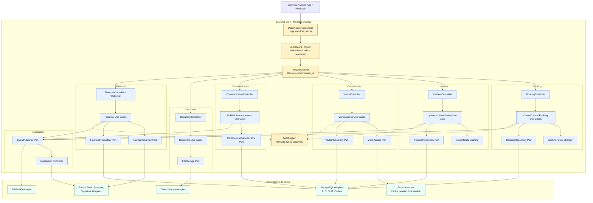
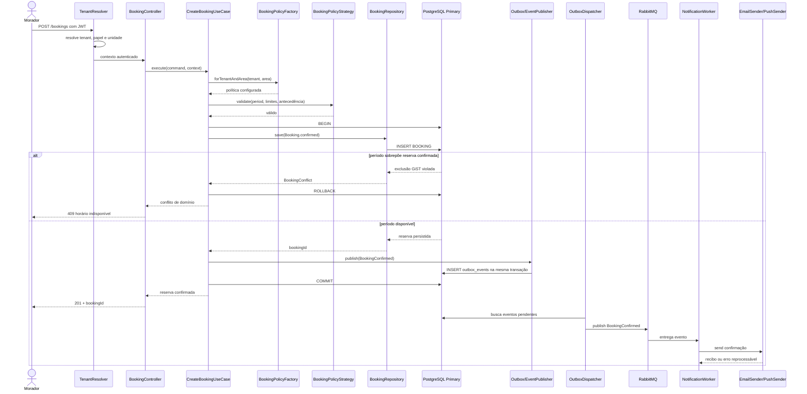
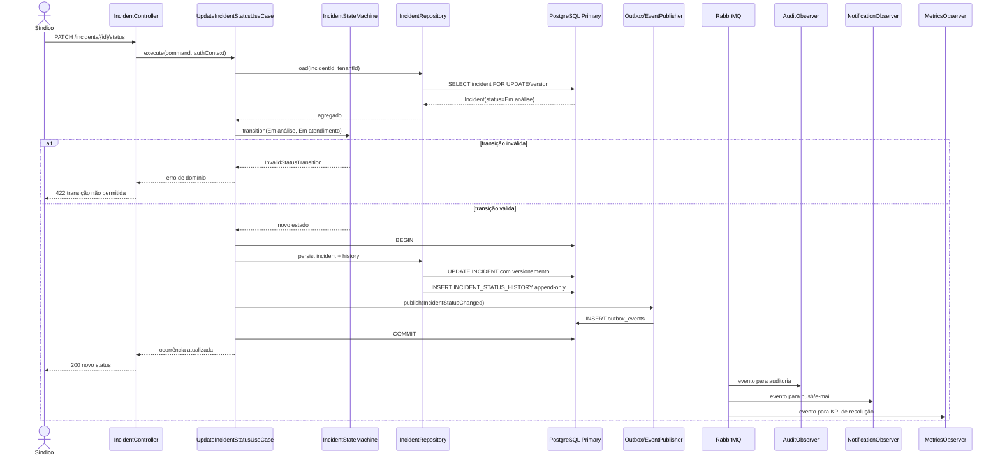
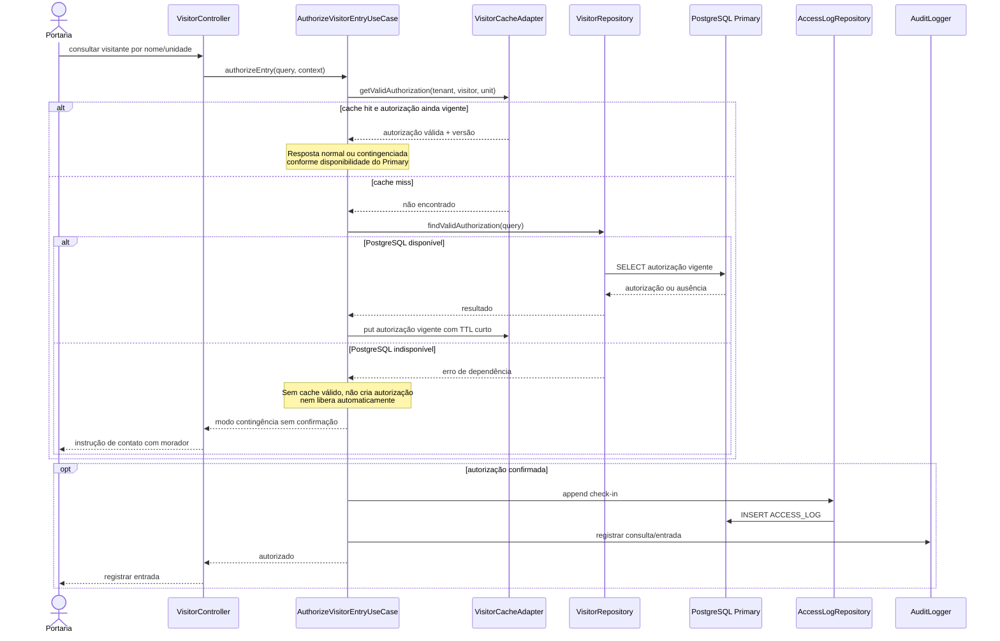
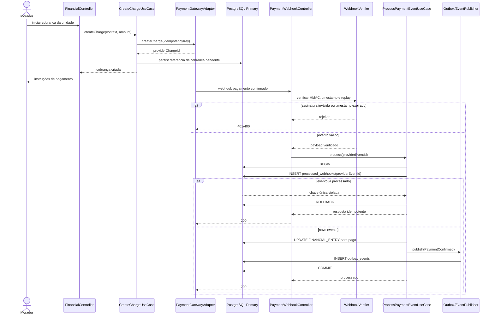

# 9. C4: Componentes (Nível 3), Código (Nível 4), Interações e Padrões GoF

## 9.1 Visão Geral e Diagrama C4 de Componentes

O container **API / BFF & Backend Core** é um monólito modular. Seus módulos são isolados por contratos de aplicação e portas, mas são implantados como uma unidade. Os componentes transversais são executados em toda requisição de entrada ou operação crítica: identificam o tenant, autenticam, autorizam, registram telemetria e preservam auditoria. Componentes de domínio não acessam diretamente adaptadores de outro módulo nem SDKs externos.



Os componentes `AuthGuard`, `TenantResolver` e `ObservabilityInterceptor` são aplicados antes de o controller delegar ao caso de uso. `AuditLogger` é acionado para ações sensíveis e também consome eventos relevantes; ele não substitui o histórico de domínio append-only. A camada de aplicação coordena os módulos, e o domínio preserva invariantes sem depender de mecanismos de transporte ou persistência.

## 9.2 Catálogo de Componentes dos Módulos Críticos

### 9.2.1 Módulo Booking

| Componente | Responsabilidade técnica | Contrato, decisão ou garantia |
|---|---|---|
| `BookingController` | Traduz HTTP/JSON em comandos de criar ou cancelar reserva; devolve resposta HTTP sem conter regra de negócio. | Requer `AuthGuard`, tenant resolvido e validação sintática de DTO; mapeia conflito persistido para HTTP `409`. |
| `CreateBookingUseCase` / `CancelBookingUseCase` | Orquestra autorização, busca de configuração, execução da política, transação, persistência e criação de evento. | Não chama e-mail diretamente; usa `EventPublisher`/Outbox após a escrita transacional. |
| `Booking` | Agregado raiz que representa uma reserva de espaço comum. | Uma reserva confirmada possui área, unidade, tenant, período válido e estado permitido. |
| `BookingPolicyStrategy` | Encapsula variações configuráveis de antecedência, limite mensal, elegibilidade e cancelamento. | Strategy é escolhida por `BookingPolicyFactory` usando configuração do condomínio/espaço. |
| `BookingRepository` | Porta de saída para buscar configuração, contar reservas aplicáveis e persistir o agregado. | Não expõe SQL nem tipos de ORM ao domínio. |
| `PostgresBookingRepository` | Adaptador PostgreSQL que persiste `BOOKING` e interpreta violações de integridade. | A constraint `EXCLUDE USING gist` é a garantia definitiva contra sobreposição; a transação devolve conflito determinístico. |
| `RedisAvailabilityCache` | Cacheia consultas elegíveis de disponibilidade, sem decidir confirmação. | Chave inclui `condominium_id`, área, data e versão/configuração; é invalidada após confirmação/cancelamento. |
| `BookingEventFactory` e `OutboxEventPublisher` | Produzem eventos técnicos padronizados e os gravam na mesma transação da reserva. | Gera `BookingConfirmed` ou `BookingCancelled` com `event_id`, `tenant_id`, versão e `correlation_id`. |

### 9.2.2 Módulo Incident

| Componente | Responsabilidade técnica | Contrato, decisão ou garantia |
|---|---|---|
| `IncidentController` | Recebe criação, consulta e atualização de status de ocorrência. | Aplica RBAC e escopo de unidade/tenant antes de invocar caso de uso. |
| `CreateIncidentUseCase` / `UpdateIncidentStatusUseCase` | Orquestra autorização, carregamento, transição, persistência do agregado e histórico. | Executa transação única para o estado atual, `INCIDENT_STATUS_HISTORY`, auditoria e Outbox. |
| `Incident` | Agregado raiz da ocorrência, com descrição, unidade, prestador opcional e status atual. | Status inicial é `Aberta`; somente transições aceitas são persistidas. |
| `IncidentStateMachine` | Política de domínio que valida transições. | `Aberta -> Em análise -> Em atendimento -> Resolvida`; não permite saltos ou retroedição silenciosa. |
| `IncidentRepository` | Porta de carregamento/persistência do agregado e do histórico. | Usa controle otimista de versão ao atualizar estado atual. |
| `PostgresIncidentRepository` | Adaptador PostgreSQL para ocorrência e histórico append-only. | Insere um novo `INCIDENT_STATUS_HISTORY` na mesma transação; perfil operacional não recebe permissão de `UPDATE`/`DELETE` no histórico. |
| `IncidentEventFactory` / `OutboxEventPublisher` | Registra `IncidentOpened` e `IncidentStatusChanged`. | Permite observadores independentes de notificação, auditoria e métricas de KPI. |
| `AuditLogger` | Registra ação sensível e contexto de segurança. | Complementa, sem duplicar como fonte de verdade, o histórico de transição do agregado. |

### 9.2.3 Módulo VisitorAccess

| Componente | Responsabilidade técnica | Contrato, decisão ou garantia |
|---|---|---|
| `VisitorController` | Oferece pré-cadastro, consulta de autorização e registro de entrada/saída. | Porta de entrada otimizada para a rotina de portaria, com RBAC restrito. |
| `CreateVisitorAuthorizationUseCase` | Cria autorização vinculada à unidade e ao intervalo de validade. | Expiração é avaliada na consulta de domínio; não depende exclusivamente de job assíncrono. |
| `AuthorizeVisitorEntryUseCase` | Consulta autorização e registra entrada/saída; trata visitante não pré-autorizado como fluxo excepcional auditável. | Mantém claramente distinto “autorização encontrada”, “não autorizada” e “modo contingência”. |
| `VisitorAuthorization` | Agregado raiz que representa a autorização. | Deve ter tenant, unidade, visitante e período de validade consistentes. |
| `VisitorRepository` / `AccessLogRepository` | Portas para autorização e registro de acesso. | Busca é indexada por tenant, nome normalizado e período; `AccessLog` é append-only. |
| `VisitorCacheAdapter` | Adaptador Redis para autorizações vigentes aptas a contingência. | Cache de TTL curto; nunca autoriza fora do escopo armazenado; sinaliza resposta contingenciada e requer reconciliação. |
| `PostgresVisitorAccessAdapter` | Implementa consultas e persistência no banco. | Fonte de verdade para autorização e logs; usa RLS e transação no registro de acesso. |
| `VisitorAccessEventFactory` | Cria eventos técnicos de acesso e expiração relevante. | Alimenta auditoria e métricas sem bloquear a portaria. |

### 9.2.4 Módulo Communication

| Componente | Responsabilidade técnica | Contrato, decisão ou garantia |
|---|---|---|
| `AnnouncementController` | Recebe publicação de comunicado, consulta de histórico e confirmação de leitura. | Somente síndico autorizado publica; leitura é limitada ao público alvo. |
| `PublishAnnouncementUseCase` | Valida segmentação, calcula audiência e persiste comunicado. | Não envia uma notificação HTTP a HTTP; publica evento após commit. |
| `Announcement` e `TargetScope` | Agregado e Value Object para título, conteúdo e escopo `all`, `block` ou `unit`. | Escopo é validado contra a estrutura do condomínio e sempre filtrado por tenant. |
| `CommunicationRepository` | Porta de persistência de comunicados e recibos. | Garante unicidade de `ReadReceipt` por anúncio/usuário. |
| `PostgresCommunicationRepository` | Adaptador relacional para segmentação e agregações de leitura. | Índices por tenant, alvo e data; consultas de leitura podem usar réplica se tolerarem defasagem. |
| `AnnouncementEventFactory` / `EventPublisher` | Produz `AnnouncementPublished` e evento de leitura quando necessário. | Factory padroniza envelope e versão; worker decide canal de entrega sem contaminar o módulo. |

### 9.2.5 Módulos Document e Financial

| Componente | Responsabilidade técnica | Contrato, decisão ou garantia |
|---|---|---|
| `DocumentController` / `DocumentService` | Cria metadados, solicita upload/download e controla acesso a documentos. | O controlador não entrega arquivos; o serviço autoriza e solicita capacidade temporária ao storage. |
| `Document` e `DocumentAccessLevel` | Agregado/metadado que classifica arquivo como público, gerencial ou de conselho. | Nenhuma URL é emitida sem avaliar tenant, papel e `access_level`. |
| `FileStorage` / `SignedUrlStorageAdapter` | Porta e adaptador para Object Storage. | URLs pré-assinadas têm método, objeto e expiração curta; prefixo de objeto é segregado por tenant. |
| `FinancialController` / `FinancialService` | Expõe consulta da própria unidade, relatório consolidado e inicia operações de cobrança permitidas. | RBAC por unidade/papel; consultas consolidadas são auditadas. |
| `FinancialEntry` | Agregado de lançamento financeiro, incluindo período, valor, tipo e status de pagamento. | Valores usam `Money`; mudanças por webhook são idempotentes e auditáveis. |
| `FinancialRepository` / `PostgresFinancialRepository` | Porta e adaptador para lançamentos e consultas agregadas. | Escritas no Primary; leituras analíticas tolerantes a lag podem ir à réplica. |
| `PaymentGateway` / `PaymentGatewayAdapter` | Porta e adaptador do provedor de pagamento. | Isola API externa; webhook é autenticado, validado por timestamp e deduplicado por evento do provedor. |
| `PaymentWebhookController` | Traduz callback externo em comando de aplicação. | Valida HMAC/assinatura antes de desserializar dados confiáveis; retorna sucesso somente após processamento idempotente ou registro seguro para reprocessamento. |

### 9.2.6 Módulo Notification

| Componente | Responsabilidade técnica | Contrato, decisão ou garantia |
|---|---|---|
| `OutboxEventPublisher` | Persiste evento técnico com o mesmo commit da alteração de negócio. | A publicação não é perdida entre commit e envio ao broker; o dispatcher pode reenviar com segurança. |
| `OutboxDispatcher` | Lê eventos pendentes, publica no broker e registra estado de despacho. | Usa lock/claim transacional e chave de idempotência; falhas transitórias são reprocessadas. |
| `RabbitMqEventBusAdapter` | Publica/consome mensagens AMQP sem expor detalhes do broker ao domínio. | Declara filas, retry e DLQ; carrega envelope versionado e `correlation_id`. |
| `NotificationWorker` | Consome evento e escolhe canal/destinatário sem alterar o estado da operação de origem. | Confirmar reserva não espera e-mail/push; consumidor é idempotente e observável. |
| `EmailSender` / `PushSender` | Portas de saída para entrega. | Adaptadores possuem timeout, retry decorado, circuit breaker e mascaramento de payload nos logs. |
| `DeliveryRepository` | Registra tentativas e estado de entrega quando necessário para auditoria/reprocessamento. | Deduplicação por `event_id`, canal e destinatário; efeitos repetidos não geram notificação duplicada intencional. |

## 9.3 Visão C4 Nível 4 — Estrutura de Código e Contratos TypeScript

O nível 4 representa uma estrutura de referência, não uma imposição de framework. A árvore abaixo mantém os nove módulos independentes, com cada módulo contendo suas vertical slices e as dependências externas concentradas em adaptadores.

```text
backend-core/
├── src/
│   ├── shared/
│   │   ├── kernel/                         # TenantId, Money, Result, DomainEvent
│   │   ├── auth/                           # AuthGuard, RBAC policies
│   │   ├── tenant/                         # TenantResolver
│   │   ├── observability/                  # logs, metrics, tracing decorators
│   │   └── audit/                          # AuditLogger port and adapter
│   ├── modules/
│   │   ├── condominium-management/
│   │   │   ├── domain/
│   │   │   ├── application/
│   │   │   ├── ports/
│   │   │   └── adapters/
│   │   ├── booking/
│   │   │   ├── domain/
│   │   │   │   ├── booking.ts
│   │   │   │   ├── booking-policy.ts
│   │   │   │   └── events/
│   │   │   ├── application/
│   │   │   │   └── create-booking/
│   │   │   │       ├── create-booking.command.ts
│   │   │   │       └── create-booking.use-case.ts
│   │   │   ├── ports/
│   │   │   │   ├── booking-repository.ts
│   │   │   │   └── event-publisher.ts
│   │   │   └── adapters/
│   │   │       ├── inbound/booking.controller.ts
│   │   │       └── outbound/postgres-booking.repository.ts
│   │   ├── visitor-access/                 # mesma estrutura hexagonal
│   │   ├── incident/                       # mesma estrutura hexagonal
│   │   ├── communication/                  # mesma estrutura hexagonal
│   │   ├── document/                       # mesma estrutura hexagonal
│   │   ├── financial/                      # mesma estrutura hexagonal
│   │   ├── service-provider/               # mesma estrutura hexagonal
│   │   └── notification/
│   │       ├── application/outbox-dispatcher.ts
│   │       ├── ports/email-sender.ts
│   │       ├── ports/push-sender.ts
│   │       └── adapters/outbound/
│   ├── infrastructure/
│   │   ├── database/
│   │   ├── cache/
│   │   ├── messaging/
│   │   └── integrations/
│   └── bootstrap/
│       ├── api.ts
│       └── worker.ts
└── tests/
    ├── unit/
    ├── integration/
    ├── contract/
    └── architecture/
```

As portas são contratos pequenos e orientados à necessidade de cada caso de uso. O domínio não recebe um repositório genérico ou um SDK de provedor; ele depende de interfaces semanticamente estáveis.

```ts
export interface BookingPolicy {
  validate(input: {
    tenantId: TenantId;
    unitId: UnitId;
    commonAreaId: CommonAreaId;
    period: BookingPeriod;
    existingMonthlyBookings: number;
  }): Result<void, BookingRuleViolation>;
}

export interface EventPublisher {
  publish(event: DomainEvent): Promise<void>;
}

export interface PaymentGateway {
  createCharge(input: CreateChargeInput): Promise<ChargeReference>;
  verifyWebhook(input: SignedWebhook): Promise<VerifiedPaymentEvent>;
}

export interface EmailSender {
  send(message: TransactionalEmail): Promise<DeliveryReceipt>;
}
```

`EventPublisher` é implementado inicialmente por um adaptador Outbox: a chamada grava o evento dentro da transação atual, não publica diretamente no RabbitMQ. O dispatcher posterior implementa a entrega ao broker. `PaymentGateway` e `EmailSender` são portas de saída; seus adaptadores podem ser substituídos sem alterar regras de reserva ou financeiro.

## 9.4 Modelagem de Interações — Diagramas de Sequência

### Cenário 1 — Criar Reserva de Espaço Comum (`US01`, `RNF-CONF-01`, `RNF-PERF-02`)

#### Diagrama 1A — ANTES: implementação acoplada e ingênua

```mermaid
sequenceDiagram
    actor Resident as Morador
    participant C as BookingController
    participant S as BookingService monolítico
    participant DB as PostgreSQL
    participant E as Provedor de E-mail

    Resident->>C: POST /bookings
    C->>S: create(dto)
    Note over S: if/else por condomínio,<br/>limite e cancelamento no mesmo método
    S->>DB: SELECT reservas no período
    DB-->>S: aparentemente disponível
    Note over S,DB: Janela de corrida: outra requisição<br/>pode consultar antes do INSERT
    S->>DB: INSERT booking sem constraint GiST
    DB-->>S: reserva persistida
    S->>E: enviar e-mail síncrono
    Note over S,E: Acoplamento a SDK/provedor;<br/>falha ou lentidão bloqueia resposta
    alt e-mail falha
        E-->>S: timeout/erro
        S-->>C: erro apesar da reserva persistida
        C-->>Resident: 500 e estado ambíguo
    else e-mail responde
        E-->>S: aceito
        S-->>C: 201
        C-->>Resident: confirmação
    end
```

Problemas do cenário anterior: regra variável em condicionais extensos, ausência de porta para persistência/integração, possível duplicidade de reserva, falha externa convertida em falha da operação principal e ausência de publicação confiável para efeitos posteriores.

#### Diagrama 1B — DEPOIS: Strategy, Factory, Observer/Outbox e constraint GiST



A constraint GiST é a garantia final de concorrência. Strategy permite regras configuráveis sem condicionais no caso de uso; Factory centraliza a seleção; Outbox e Observer por evento tornam a notificação posterior e recuperável, sem bloquear a resposta de criação.

### Cenário 2 — Atualizar Status de Ocorrência (`US07`, `RNF-CONF-02`)



O estado atual e o histórico são persistidos atomicamente. O `IncidentStateMachine` mantém a invariável do fluxo, enquanto os observadores recebem o evento após o commit e não interferem no sucesso da atualização.

### Cenário 3 — Autorização e Entrada de Visitante com Fallback/Cache (`US04`, `US05`, `RNF-DISP-02`)



O fallback é propositalmente limitado: um cache válido pode responder à autorização previamente conhecida; sem fonte de verdade e sem cache ainda válido, a plataforma não fabrica uma autorização. O fluxo de exceção previsto em `US05` exige contato com o morador e registro auditável.

### Cenário 4 — Pagamento de Taxa Condominial e Webhook Idempotente (`US12`)



O Gateway de Pagamento não atualiza diretamente o lançamento financeiro. O webhook cruza uma fronteira de confiança, por isso sua assinatura e janela temporal são verificadas antes do processamento. A tabela de eventos processados impede que reentregas alterem o mesmo lançamento mais de uma vez.

## 9.5 Padrões GoF Aplicados

| Padrão GoF | Problema concreto no SaaS Condominial | Aplicação técnica (classes/contratos) | Benefícios obtidos | Custos / consequências negativas | Alternativa simples considerada |
|---|---|---|---|---|---|
| **Strategy** | Regras de reserva variam por condomínio e área: limite mensal, antecedência, cancelamento e elegibilidade. Condicionais crescentes tornam o caso de uso frágil. | `BookingPolicy`, estratégias por configuração e `BookingPolicyFactory`; `IncidentStateMachine` também encapsula transições permitidas. | Extensão de política sem modificar o caso de uso; regras testáveis isoladamente; menor acoplamento entre configuração e fluxo. | Mais classes/registro de políticas; combinações de configuração exigem testes e observabilidade. | Um único `if/else` no `BookingService`; descartado porque há três ou mais variações reais de regra. |
| **Factory Method** | Eventos técnicos de reserva, ocorrência, comunicação e financeiro exigem envelope consistente, versão, tenant e correlação. | `BookingEventFactory`, `IncidentEventFactory`, `AnnouncementEventFactory` e `PaymentEventFactory` criam `DomainEvent`/evento técnico. | Padroniza contratos, reduz montagem duplicada e torna versionamento/auditoria uniforme. | Introduz objetos extras e pode esconder fluxo se usado para objetos simples sem variação. | Instanciar objetos literais em cada caso de uso; inadequado após múltiplos tipos de evento e consumidores. |
| **Observer** | Uma alteração de domínio deve causar notificação, auditoria e métrica sem que o agregado conheça canais ou destinos. | Eventos de domínio persistidos no Outbox; consumidores/handlers para `AuditObserver`, `NotificationObserver` e `MetricsObserver`. | Desacopla efeitos secundários; permite adicionar consumidor sem alterar o produtor; tolera indisponibilidade externa. | Consistência eventual, depuração distribuída e necessidade de idempotência/DLQ. | Chamar e-mail, auditoria e métrica diretamente no serviço; descartado por acoplamento e bloqueio do fluxo crítico. |
| **Adapter** | E-mail, push, storage, pagamento e assinatura possuem SDKs, protocolos e autenticações distintos. | `EmailSender`, `PushSender`, `FileStorage`, `PaymentGateway`, `SignatureProvider` e seus adaptadores concretos. | O domínio não depende de fornecedor; testes usam fakes; troca de provedor é localizada. | Mapeamentos e testes de contrato adicionais; não elimina diferenças semânticas reais do fornecedor. | Chamar SDKs diretamente no caso de uso; descartado por violar a fronteira hexagonal. |
| **Decorator** | Clientes externos precisam das mesmas preocupações técnicas: timeout, retry, circuito, métricas e mascaramento de logs. | `RetryingEmailSender`, `ObservedPaymentGateway`, `CircuitBreakingPushSender` decoram portas já implementadas. | Reuso de resiliência/telemetria sem poluir casos de uso; composição por ambiente. | Ordem dos decorators influencia comportamento; cadeia excessiva dificulta diagnóstico. | Repetir `try/catch` em cada adaptador; inadequado após múltiplas integrações e preocupações transversais. |

## 9.6 Critérios para Aplicação de Padrões e Regra dos Três

Padrões são adotados para remover uma fonte comprovada de variação ou de acoplamento, não para aumentar a quantidade de abstrações. A **Regra dos Três** é aplicada da seguinte forma:

1. Mantém-se solução direta quando existe uma única necessidade ou quando a segunda variação ainda é hipotética.
2. Na segunda ocorrência, registra-se a semelhança e mede-se se a duplicação é acidental ou se os contextos realmente divergem.
3. A partir de três variações reais, ou quando existe uma terceira variação aprovada e iminente, extrai-se uma abstração com contrato restrito, acompanhada de testes e observabilidade.

Os padrões deste documento atendem essa regra:

- **Strategy** é justificado porque regras de reserva variam em, pelo menos, limite mensal, antecedência e cancelamento, além de poderem variar por condomínio e área comum.
- **Adapter** é justificado pelas cinco integrações externas heterogêneas: e-mail, push, Object Storage, pagamento e assinatura digital.
- **Observer** é justificado pelos múltiplos consumidores independentes de eventos: auditoria, notificações e métricas/KPIs.
- **Factory Method** é justificado pelas famílias de eventos de reserva, ocorrência, comunicado e pagamento que precisam do mesmo envelope técnico.
- **Decorator** é justificado por timeout, retry, circuit breaker e telemetria aplicados a mais de uma porta externa.

Deliberadamente, **não** são introduzidos padrões onde não há variação suficiente:

- Não há `Abstract Factory` para bancos de dados: PostgreSQL é a decisão aprovada e não existem três implementações de persistência a suportar.
- Não há `Command` object genérico para toda operação: comandos são DTOs/casos de uso simples; somente operações que precisam de fila, auditoria ou idempotência recebem objetos explícitos.
- Não há `Facade` adicional para cada módulo: o Application Service já é a fronteira de orquestração e inserir outra fachada duplicaria responsabilidade.
- Não há `Chain of Responsibility` genérica para RBAC: `AuthGuard` e Policies declarativas cobrem o fluxo atual com legibilidade superior.
- Não há `Prototype` para agregados: cópia de reserva, ocorrência ou lançamento não é uma necessidade de domínio aprovada e poderia introduzir duplicação de estado indevida.

---

# 10. Modelo de Domínio Técnico (DDD Tático)

## 10.1 Agregados, Entidades e Objetos de Valor

| Elemento técnico e classificação DDD | Módulo | Responsabilidade | Invariantes de domínio e regras de consistência |
|---|---|---|---|
| **`Booking` — Agregado raiz** | Booking | Representa a reserva de uma área comum por uma unidade. | Possui tenant, unidade, área e `BookingPeriod` válido; reserva confirmada não sobrepõe outra confirmada na mesma área; limite mensal e antecedência são validados por política; cancelamento respeita política configurada. |
| **`Incident` — Agregado raiz** | Incident | Representa ocorrência formal, seu estado atual e eventual atribuição a prestador. | É criado como `Aberta`; transições obedecem à máquina de estados; toda mudança válida cria histórico append-only; pertence a uma unidade e tenant. |
| **`VisitorAuthorization` — Agregado raiz** | VisitorAccess | Representa pré-autorização de visitante vinculada a unidade e validade. | Deve possuir visitante, unidade, tenant e período válido; expiração é calculada no momento da consulta; não autoriza outra unidade/tenant. |
| **`Announcement` — Agregado raiz** | Communication | Representa comunicado oficial e sua segmentação. | Tem emissor autorizado, tenant e `TargetScope` válido; público é sempre derivado dentro do condomínio; publicação gera evento após persistência. |
| **`Document` — Agregado raiz** | Document | Representa metadados, classificação e referência de arquivo externo. | O objeto de storage pertence ao prefixo do tenant; `DocumentAccessLevel` é obrigatório; URL é efêmera e emitida somente após autorização. |
| **`FinancialEntry` — Agregado raiz** | Financial | Representa taxa, despesa ou lançamento associado à unidade e período. | Valor é `Money`; tenant e unidade são obrigatórios quando aplicáveis; confirmação externa é idempotente; transições de pagamento são auditáveis. |
| **`Condominium` — Agregado raiz** | CondominiumManagement | Raiz administrativa do tenant, com configurações e estrutura condominial. | Define o escopo do tenant; configurações de reserva são versionadas; não há referência entre unidades de condomínios diferentes. |
| **`Unit` — Entidade interna** | CondominiumManagement | Identifica unidade residencial que abriga moradores, reservas, visitantes e lançamentos. | Pertence a um único bloco/condomínio; somente usuários vinculados podem agir em seu escopo quando o papel exigir. |
| **`Block` — Entidade interna** | CondominiumManagement | Agrupa unidades para estrutura e segmentação. | Pertence a um único condomínio; não pode ser usado como alvo de comunicação de outro tenant. |
| **`AccessLog` — Entidade interna / registro append-only** | VisitorAccess | Registra entrada e saída, incluindo acesso sem pré-autorização. | Registra timestamp e funcionário responsável; não é editável silenciosamente; acesso excepcional mantém motivo e referência de contato quando necessário. |
| **`IncidentStatusHistory` — Entidade interna / registro append-only** | Incident | Registra cada transição de status da ocorrência. | Contém estado anterior, novo estado, autor e instante; é inserido na mesma transação da mudança de estado; não sofre edição retroativa operacional. |
| **`ReadReceipt` — Entidade interna** | Communication | Registra confirmação de leitura de comunicado. | É único por par anúncio/usuário; data de leitura é imutável; usuário deve pertencer à audiência do comunicado. |
| **`TenantId` — Value Object** | Shared Kernel | Representa de forma tipada o identificador do condomínio. | Nunca é opcional em recursos multi-tenant; participa de filtros, RLS, cache, logs e eventos. |
| **`TimeSlot` / `BookingPeriod` — Value Object** | Booking | Representa intervalo temporal de reserva. | Início é anterior ao fim; fuso horário é normalizado; não permite período inválido; usado pela constraint temporal no banco. |
| **`Money` — Value Object** | Financial | Representa quantia monetária e moeda sem erro de ponto flutuante. | Valor usa decimal/integer menor unidade; moeda é explícita; operações respeitam arredondamento definido. |
| **`IncidentStatus` — Value Object / enum de domínio** | Incident | Representa os estados permitidos da ocorrência. | Valores fechados: `Aberta`, `Em análise`, `Em atendimento`, `Resolvida`; transições são controladas por `IncidentStateMachine`. |
| **`DocumentAccessLevel` — Value Object / enum de domínio** | Document | Representa nível de sigilo do documento. | Valores permitidos: `public`, `manager`, `council`; qualquer emissão de URL exige compatibilidade com papel/tenant. |
| **`TargetScope` — Value Object** | Communication | Representa escopo do comunicado. | Valores permitidos: `all`, `block`, `unit`; bloco/unidade devem pertencer ao tenant do comunicado. |

## 10.2 Persistência e Detalhamento Físico — Ponte para o Anexo D

O modelo relacional preserva as fronteiras de agregados sem tentar reproduzir objeto por objeto em tabelas genéricas. Cada agregado possui uma tabela raiz e tabelas internas quando há histórico ou cardinalidade própria. O mapeamento mantém chaves primárias estáveis, chaves estrangeiras explícitas, `condominium_id` em recursos multi-tenant e índices compostos compatíveis com os padrões de consulta.

| Decisão de persistência | Aplicação técnica | Justificativa e consistência |
|---|---|---|
| Fonte transacional de verdade | PostgreSQL Primary para escritas e leituras consistentes. | O domínio possui relacionamentos fortes e invariantes que exigem ACID, especialmente `Booking` e `Incident`. |
| Fronteira transacional de agregado | Uma transação modifica um agregado e seus registros internos imediatos. | Confirmar reserva grava `BOOKING` e Outbox; alterar ocorrência grava `INCIDENT`, `INCIDENT_STATUS_HISTORY` e Outbox; processar pagamento grava lançamento, webhook processado e Outbox. |
| Concorrência otimista | Coluna de versão ou comparação de estado no `Incident` e demais agregados com atualização concorrente não temporal. | Evita sobrescrita silenciosa; falha de versão retorna conflito de aplicação para nova leitura/decisão do usuário. |
| Concorrência temporal de reserva | Constraint PostgreSQL `EXCLUDE USING gist` sobre área comum, intervalo temporal e status bloqueante. | É a garantia final contra sobreposição, inclusive quando duas requisições passam pela validação de aplicação simultaneamente. Lock Redis é apenas otimização auxiliar. |
| Multi-tenancy e RLS | `condominium_id` obrigatório e Row-Level Security nas tabelas de domínio. | O contexto do tenant é configurado por transação/conexão segura; políticas impedem leitura/escrita cruzada mesmo diante de erro de filtro na aplicação. |
| Históricos imutáveis | `INCIDENT_STATUS_HISTORY` e `ACCESS_LOG` são append-only; auditoria é mantida separadamente. | Preserva evidência de processo e evita edição retroativa silenciosa; permissões de banco restringem alteração operacional. |
| Outbox transacional | Tabela `outbox_events` com evento, versão, tenant, correlação, payload, estado de despacho e tentativas. | Elimina a lacuna entre commit do negócio e publicação no broker; dispatcher publica de forma idempotente, com retry e DLQ. |
| Leitura e réplica | PostgreSQL Read Replica para relatórios e consultas tolerantes a defasagem. | Escritas, confirmação de reserva, consulta crítica de visitante e leituras que exigem consistência permanecem no Primary. |
| Objetos binários | Metadados em `DOCUMENT`; arquivos em Object Storage segregado por prefixo de tenant. | Evita carga de binários no banco e permite URLs assinadas; autorização é decidida pelo domínio antes da emissão da URL. |

O DDL completo, incluindo extensões necessárias, tabelas, chaves, índices, políticas RLS, constraint GiST, permissões append-only e `outbox_events`, será apresentado no **Anexo D — Modelo Físico de Dados e DDL SQL**. A especificação de cada tabela no Anexo D deverá preservar as invariantes deste modelo, e qualquer alteração em sua estrutura que modifique essas invariantes exigirá revisão do ADR de dados e dos testes de integração correspondentes.
