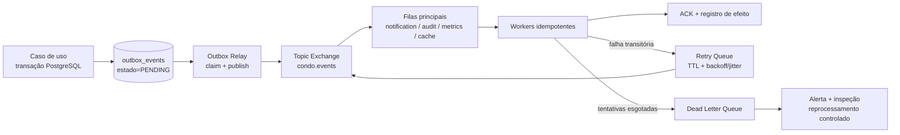

# 12. Segurança

## 12.1 Autenticação e Gestão de Sessão

A identidade é provida por OAuth 2.1 / OpenID Connect (OIDC). Web App e Mobile App obtêm tokens por fluxos apropriados a cliente público, com PKCE. A API valida assinatura, emissor, audiência, expiração e escopos do JWT antes de qualquer caso de uso, atendendo `RNF-SEG-01`.

| Controle | Decisão operacional | RNFs/ADRs relacionados |
|---|---|---|
| Access Token | JWT de curta duração: **15 minutos**; contém `sub`, papéis, escopo de tenant/unidade permitido, emissor, audiência, `jti` e `exp`; não contém PII desnecessária. | RNF-SEG-01, RNF-SEG-04, RNF-SEG-05, ADR-001 |
| Refresh Token | Token opaco, rotativo e armazenado apenas como hash. A família de token é registrada no Redis com TTL de inatividade e metadados mínimos de dispositivo/sessão. | RNF-SEG-03, ADR-002 |
| Revogação imediata | Logout, troca de senha, suspeita de fraude, remoção de papel ou mudança crítica invalidam a família no Redis. Access tokens já emitidos são verificados contra lista de revogação por `jti` até expiração. | RNF-SEG-03, RNF-SEG-06, ADR-002 |
| Expiração por inatividade | Cada uso legítimo renova somente a janela de inatividade do refresh token. Ao expirar, exige autenticação OIDC completa. Não há renovação ilimitada. | RNF-SEG-03 |
| Recuperação de senha | Token aleatório criptograficamente seguro, de uso único, TTL curto, persistido somente em hash; solicitação com rate limit e resposta neutra para não enumerar e-mails. | RNF-SEG-02, RNF-SEG-10 |
| MFA | MFA obrigatório para Síndico e Administrador; recomendado/exigível por política para Conselheiro. Preferência por TOTP ou passkey; códigos de recuperação são exibidos uma única vez e armazenados protegidos. | RNF-SEG-04, RNF-SEG-06, RNF-SEG-10 |
| Segredos e chaves | Chaves de assinatura, credenciais OIDC e segredos de provedores ficam em Secrets Manager, com rotação e acesso por workload identity. | RNF-SEG-10, ADR-002 |

O `AuthGuard` não considera um token válido como autorização suficiente. O token identifica o ator; a autorização é reavaliada para o recurso, tenant e unidade solicitados. Isso impede que a ocultação de botões no cliente seja tratada como controle de segurança.

## 12.2 Autorização em Profundidade: RBAC, Escopo de Unidade e RLS

A autorização combina três barreiras independentes:

1. **Backend:** `AuthGuard` valida a identidade; `RBAC Policy` verifica papel, ação e recurso; `ResourceScopePolicy` verifica `condominium_id`, unidade, atribuição de prestador e `access_level`.
2. **Dados:** PostgreSQL aplica Row-Level Security (RLS) com `condominium_id`, configurado por transação com `SET LOCAL app.current_tenant`. A role operacional não possui `BYPASSRLS`.
3. **Cliente e interface:** Web/Mobile mostram apenas operações permitidas, mas essa é uma medida de UX, não uma fronteira de confiança.

| Perfil | Escopo de autorização no backend | Proteção adicional no dado |
|---|---|---|
| Morador | Recursos da própria unidade/família: reservas, visitantes, ocorrências, leitura e financeiro próprio. | RLS por tenant e predicado de `unit_id` aplicado em query/policy; nenhum acesso a outra unidade. |
| Síndico | Operação completa no próprio condomínio: ocorrências, comunicados, documentos, prestadores e financeiro. | RLS limita ao tenant; auditoria obrigatória para ações sensíveis. |
| Administrador | Configuração estrutural, usuários, perfis e permissões somente nos condomínios delegados. | RLS por tenant; acesso multi-condomínio é explícito, com contexto por transação e trilha de auditoria. |
| Funcionário/Portaria | Consulta/registro de visitantes e ocorrências operacionais. Sem financeiro ou documentos sigilosos. | RLS por tenant; Policies negam recursos fora de VisitorAccess/Incident permitido. |
| Conselheiro | Leitura de documentos permitidos e prestação de contas consolidada. | RLS por tenant e `DocumentAccessLevel`; sem ações de escrita operacional. |
| Prestador de Serviço | Somente ordens, contratos e ocorrências atribuídas. | RLS por tenant combinada à associação `service_provider_id`; sem visão de outros prestadores. |

Essa defesa em profundidade atende `RNF-SEG-04`, `RNF-SEG-05` e `RNF-SEG-06`. Para recursos financeiros e documentos sigilosos, a emissão de uma URL assinada ou de uma consulta consolidada ocorre somente após a Policy de aplicação e o filtro de dados (`RNF-SEG-09`). A implementação de RLS e do contexto transacional é estabelecida pelo ADR-001.

## 12.3 Auditoria Imutável

Alterações sensíveis, consultas a PII e acesso a documentos sigilosos produzem registros de auditoria. Auditoria não substitui o histórico de domínio: `INCIDENT_STATUS_HISTORY` e `ACCESS_LOG` continuam append-only para representar fatos do negócio, enquanto `audit_events` registra evidência transversal de segurança e operação.

| Campo do registro | Finalidade |
|---|---|
| `audit_event_id` | Identificador imutável e rastreável. |
| `occurred_at_utc` | Timestamp UTC com precisão de milissegundo. |
| `tenant_id` | Condomínio do recurso; obrigatório para evento multi-tenant. |
| `actor_id`, `actor_role` | Quem executou a operação e sob qual papel efetivo. |
| `source_ip`, `user_agent`, `session_id` | Contexto de origem, investigação e detecção de anomalia. |
| `operation`, `resource_type`, `resource_id` | Ação realizada e alvo: leitura, criação, alteração, exportação ou negação. |
| `before_jsonb`, `after_jsonb` | Estado antes/depois com mascaramento de segredos e PII não necessária. |
| `decision`, `reason_code` | Resultado permitido/negado e motivo técnico/negocial. |
| `correlation_id`, `trace_id` | Correlação entre API, banco, Outbox, worker e integração. |

`audit_events`, `INCIDENT_STATUS_HISTORY` e `ACCESS_LOG` são somente-inserção para a role operacional; alterações ou remoções exigem procedimento controlado, identidade break-glass e registro próprio. Acesso a dados pessoais, documentos `manager`/`council` e financeiro consolidado é auditado, incluindo tentativas negadas. Isso atende `RNF-CONF-02`, `RNF-SEG-09` e `RNF-SEG-11`.

## 12.4 Proteção de Dados e Conformidade LGPD

| Controle | Aplicação |
|---|---|
| Criptografia em trânsito | TLS 1.3 no Ingress público e HTTPS para integrações; TLS também entre workloads e dados quando suportado. Certificados são renovados automaticamente. |
| Criptografia em repouso | AES-256 para volumes do PostgreSQL, backups, Object Storage, snapshots e Redis gerenciado quando disponível. Chaves são gerenciadas e rotacionadas pelo KMS/Secrets Manager. |
| Minimização e classificação | PII de moradores, dependentes, visitantes e prestadores é coletada somente para finalidade declarada. Financeiro e documentos restritos recebem classificação mais alta. |
| Mascaramento | Logs nunca carregam senha, refresh token, JWT, assinatura HMAC, documento ou PII integral. E-mail, telefone, CPF/identificador e nome de visitante são mascarados ou hashados conforme a finalidade. |
| Retenção | Dados e logs possuem tabelas de retenção alinhadas à finalidade, obrigação legal, investigação de segurança e direitos do titular. |
| Direitos do titular | Endpoints e fluxo administrativo para solicitação de acesso, retificação, portabilidade quando aplicável, anonimização/exclusão e acompanhamento de protocolo. A identidade do solicitante é verificada antes do atendimento. |
| Exclusão sem romper integridade | Dados que precisam manter evidência fiscal, financeira, de segurança ou auditoria são anonimizados/pseudonimizados quando a exclusão física não for legalmente possível. FKs e agregados permanecem íntegros. |

O fluxo LGPD registra solicitação, identidade verificada, tipo de pedido, aprovação, execução e evidência de conclusão. Dados de visitante são tratados com finalidade de controle de acesso; não são reutilizados para comunicação ou perfilamento. Esses controles atendem `RNF-SEG-07`, `RNF-SEG-08` e `RNF-SEG-10`.

---

# 13. Observabilidade

## 13.1 Logs Estruturados

Todos os workloads geram JSON estruturado e centralizam logs em agregador protegido. O padrão preserva contexto para investigação sem registrar segredo ou PII em excesso. Campos mínimos: `timestamp`, `level`, `service`, `environment`, `event_name`, `correlation_id`, `trace_id`, `condominium_id`, `actor_id` pseudonimizado, `resource_id`, `result`, `latency_ms` e erro normalizado.

```json
{
  "timestamp": "2026-10-11T23:30:14.321Z",
  "level": "INFO",
  "service": "backend-core",
  "environment": "production",
  "event_name": "BookingConfirmed",
  "correlation_id": "cor-2f1d",
  "trace_id": "4bf92f3577b34da6a3ce929d0e0e4736",
  "condominium_id": "tenant-7c3",
  "actor_id": "usr-hash-91e",
  "resource_id": "booking-143",
  "result": "success",
  "latency_ms": 186
}
```

```json
{
  "timestamp": "2026-10-11T23:31:02.098Z",
  "level": "INFO",
  "service": "backend-core",
  "event_name": "IncidentStatusChanged",
  "correlation_id": "cor-9ab0",
  "condominium_id": "tenant-7c3",
  "actor_id": "usr-hash-manager-21",
  "resource_id": "incident-845",
  "previous_status": "Em análise",
  "new_status": "Em atendimento",
  "result": "success",
  "latency_ms": 92
}
```

```json
{
  "timestamp": "2026-10-11T23:31:35.551Z",
  "level": "INFO",
  "service": "backend-core",
  "event_name": "VisitorCheckedIn",
  "correlation_id": "cor-0cd4",
  "condominium_id": "tenant-7c3",
  "actor_id": "usr-hash-concierge-18",
  "resource_id": "access-log-901",
  "authorization_source": "postgresql",
  "result": "authorized",
  "latency_ms": 74
}
```

Logs de erro carregam `error_code`, `error_class`, `retryable`, `dependency` e stack trace protegido para ambiente interno. Isso atende `RNF-OBS-01` e complementa `RNF-SEG-11`.

## 13.2 Métricas Técnicas RED/USE e Métricas de Negócio

### Métricas técnicas

| Categoria | Métrica | Uso operacional |
|---|---|---|
| RED — Rate | Requisições por segundo por endpoint, tenant e resposta HTTP. | Dimensionar HPA, identificar abuso e acompanhar throughput de pico. |
| RED — Errors | Taxa HTTP 5xx, 4xx por classe, falhas de autenticação, conflito de reserva e falhas de webhook. | Distinguir erro de plataforma, regra de negócio e tentativa indevida. |
| RED — Duration | Latência p50/p95/p99 de consulta, reserva, portaria e callback externo. | Verificar `RNF-PERF-01`/`RNF-PERF-02` e orçamento de latência. |
| USE — Utilization | CPU/memória de pods, conexões e I/O do PostgreSQL, uso de Redis, workers ativos. | Detectar saturação antes da indisponibilidade. |
| USE — Saturation | Fila de conexões PostgreSQL, lock waits, idade/profundidade RabbitMQ, DLQ, eviction Redis. | Acionar escala, investigação ou proteção de dependência. |
| Disponibilidade | Sucesso de probes, uptime de API, taxa de erro sintético e disponibilidade por jornada crítica. | Medir SLO/SLA de `RNF-DISP-01`. |

### Métricas de negócio

| KPI / métrica | Fórmula ou origem | Decisão suportada |
|---|---|---|
| Taxa de adoção | moradores ativos no período / moradores ou unidades elegíveis | Mede adoção e necessidade de onboarding. |
| Tempo médio de resolução de ocorrência | média entre `opened_at` e `resolved_at` por tenant/categoria | Mede eficiência do fluxo `US06`/`US07`. |
| Colisões de reserva evitadas | contagem de conflitos GiST/Policy retornados como HTTP `409` | Mede benefício da automação de `US01`. |
| Taxa de confirmação de leitura | `ReadReceipt` / audiência segmentada | Mede alcance de comunicados `US09`/`US10`. |
| Tempo de atendimento da portaria | média/p95 entre consulta e `AccessLog.checked_in_at` | Mede operação de `US04`/`US05` e contingência. |
| Entrega de notificação | enviadas, confirmadas, retry e DLQ por canal | Mede eficiência sem confundir atraso de notificação com falha do core. |
| Situação financeira consultada | consultas próprias/consolidadas por período, sem expor valor individual em métrica | Mede adoção de `US12`/`US13` preservando privacidade. |

Essas métricas atendem `RNF-OBS-02` e os KPIs aprovados na Visão de Negócio.

## 13.3 Tracing Distribuído e Alertas

O contexto W3C Trace Context é propagado em HTTP, AMQP e callbacks internos: **Web/Mobile -> Ingress -> API -> PostgreSQL/Redis -> Outbox/RabbitMQ -> Worker -> provedor externo**. OpenTelemetry cria spans para autorização, resolução de tenant, query crítica, cache, publicação/consumo de evento e adaptação externa. Webhooks iniciam novo trace e preservam `correlation_id` do fornecedor quando seguro.

| Alerta acionável | Condição inicial | Severidade e primeira ação |
|---|---|---|
| Erro de API | HTTP 5xx acima de 2% por 5 min em jornada crítica | Alta: validar rollout, dependência e traces; pausar deploy se correlacionado. |
| Latência de reserva | p95 acima de 800 ms por 10 min ou p99 acima de 1,5 s | Alta: inspecionar locks/índice GiST, pool PostgreSQL e saturação de API. |
| Portaria indisponível | sintético de consulta falha por 2 min ou fallback cache ativo acima de 15 min | Crítica: acionar runbook de contingência, banco/cache/rede e comunicação operacional. |
| Backlog de fila | idade p95 acima de 5 min, backlog crescente por 15 min ou DLQ maior que zero | Alta: escalar worker, verificar provedor, analisar evento e reprocessar com segurança. |
| Banco de dados | conexões acima de 80%, lock wait prolongado, replica lag acima de 60 s ou backup falho | Alta/Crítica: limitar carga, investigar query, restaurar capacidade e validar backup. |
| Segurança | picos de `401`/`403`, falha de HMAC, uso de break-glass ou acesso cross-tenant negado | Alta: investigar origem, rotacionar credencial quando aplicável e preservar evidência. |

Alertas devem apontar para runbook, dashboard e responsável. Um alerta sem ação definida é tratado como ruído e revisado. Isso atende `RNF-OBS-03`.

---

# 14. Estratégia de Cache

O cache segue o ADR-002: melhora leitura e contingência, mas nunca substitui a fonte transacional de verdade. Todas as chaves têm isolamento explícito por tenant e métricas de hit, miss, latência e eviction.

| Recurso elegível | Chave de tenant | TTL máximo | Invalidação explícita | Regra de uso |
|---|---|---|---|---|
| Catálogo de áreas comuns e regras de reserva | `tenant:{condominium_id}:common-area:{area_id}:v:{version}` | 15 min | Alteração de área, horário ou policy; versão de configuração. | Pode acelerar exibição e pré-validação; a confirmação consulta/persiste no PostgreSQL. |
| Disponibilidade de reserva por dia | `tenant:{condominium_id}:availability:{area_id}:{yyyy-mm-dd}:v:{version}` | 60 s | Reserva confirmada/cancelada ou alteração de regra. | Somente sugestão de disponibilidade; nunca decisão final de conflito. |
| Autorizações de visitante vigentes | `tenant:{condominium_id}:visitor-auth:{normalized-hash}:{unit_id}` | Menor entre 5 min e `valid_until` | Revogação, alteração, expiração ou check-in que altere elegibilidade. | Pode suportar fallback de portaria quando marcado como cache válido; sem entrada válida, não autoriza. |
| Sessão e revogação | `session:{session_id}` e `revocation:{jti}` | Inatividade configurada e expiração do token | Logout, troca de senha, revogação de papel ou suspeita de fraude. | Fonte operacional de sessão/revogação, não de dados de negócio persistente. |
| Metadados de permissão | `tenant:{condominium_id}:rbac:{actor_id}:v:{version}` | 5 min | Mudança de perfil, vínculo de unidade ou permissão. | Reduz lookup repetitivo; ação sensível pode forçar revalidação no banco. |
| URL pré-assinada | Não é cache compartilhado; emitida por solicitação autorizada. | Expiração curta definida pelo tipo de arquivo/operação. | Não aplicável; expira naturalmente e pode ser invalidada pela política do objeto. | Nunca persiste em cache de cliente compartilhado ou log. |

**Nunca são cacheados como fonte de decisão final:** confirmação transacional de conflito de reserva, saldo/lançamento financeiro que mude uma autorização, transição de ocorrência, validação de assinatura de webhook, decisão de RBAC para ação administrativa crítica e segredo/token. Em oscilação de Redis, a aplicação usa fallback ao PostgreSQL para operações consistentes, aplica circuit breaker e alerta; não retorna sucesso baseado em dado ausente (`RNF-PERF-01`, `RNF-DISP-02`).

---

# 15. Estratégia de Filas e Mensageria

O ADR-003 define RabbitMQ, Transactional Outbox, retry e DLQ. O produtor grava o fato de negócio e `outbox_events` na mesma transação. O relay publica o evento em Topic Exchange somente após commit; consumidores idempotentes processam ao-menos-uma-vez.

| Evento de negócio | Evento técnico (routing key) | Fila consumidora | Produtor | Ações assíncronas executadas |
|---|---|---|---|---|
| Reserva confirmada | `booking.confirmed.v1` | `notification.booking`, `audit.booking`, `metrics.booking` | Booking / Outbox Relay | E-mail/push, auditoria, contador de reservas e conflitos evitados. |
| Reserva cancelada | `booking.cancelled.v1` | `notification.booking`, `audit.booking`, `cache.invalidate` | Booking / Outbox Relay | Aviso à portaria/morador, auditoria e invalidação de disponibilidade. |
| Ocorrência criada | `incident.opened.v1` | `notification.incident`, `audit.incident`, `metrics.incident` | Incident / Outbox Relay | Notificação ao síndico, auditoria e métrica de abertura. |
| Status de ocorrência alterado | `incident.status-changed.v1` | `notification.incident`, `audit.incident`, `metrics.incident` | Incident / Outbox Relay | Push/e-mail, atualização de KPI de resolução e trilha auditável. |
| Comunicado publicado | `communication.announcement-published.v1` | `notification.communication`, `audit.communication` | Communication / Outbox Relay | Segmentação/delivery por e-mail/push e auditoria. |
| Visitante pré-autorizado | `visitor.authorized.v1` | `notification.visitor`, `cache.invalidate`, `audit.visitor` | VisitorAccess / Outbox Relay | Aviso à portaria/morador, atualização de cache e auditoria. |
| Entrada na portaria registrada | `visitor.checked-in.v1` | `audit.visitor`, `metrics.visitor` | VisitorAccess / Outbox Relay | Registro de segurança e métrica operacional; notificação somente se regra futura exigir. |
| Pagamento confirmado | `financial.payment-confirmed.v1` | `notification.financial`, `audit.financial`, `metrics.financial` | Financial / Outbox Relay | Atualização ao morador, auditoria e métricas financeiras agregadas. |
| Documento assinado | `document.signed.v1` | `notification.document`, `audit.document`, `cache.invalidate` | Document / Outbox Relay | Notificação autorizada, auditoria e invalidação de metadados. |

## 15.1 Topologia de broker e fluxo do Outbox Relay



- **Topic Exchange:** `condo.events`, com routing keys versionadas e sem wildcard permissivo para dados sensíveis.
- **Filas principais:** separadas por responsabilidade para que notificação não bloqueie auditoria, métricas ou invalidação de cache.
- **Retry queues:** possuem TTL progressivo, por exemplo 30 s, 5 min e 30 min; a mensagem retorna ao exchange com contador de tentativas e jitter na programação.
- **DLQ:** retém payload mínimo, cabeçalhos, erro e correlação. Só é reprocessada mediante runbook e correção da causa; reprocessar não pode gerar efeito duplicado.
- **Outbox Relay:** usa claim transacional e publisher confirms; evento somente recebe estado `PUBLISHED` após confirmação do broker. Eventos presos ou antigos acionam alerta.

Essa estratégia atende `RNF-PERF-03`, `RNF-DISP-03` e `RNF-ESC-03`.

---

# 16. Resiliência e Tolerância a Falhas

| Dependência / fluxo | Timeout | Retry e backoff | Circuit breaker | Bulkhead | Fallback seguro |
|---|---|---|---|---|---|
| Provedor de e-mail/push | 3 s por tentativa | 3 tentativas: exponencial com jitter; depois DLQ | Abre após 5 falhas consecutivas ou 50% de erro em janela de 30 s; half-open com 1 chamada de teste após 30 s | Pool/fila dedicado por canal | Retém evento; não bloqueia operação de origem. |
| Gateway de pagamento | 5 s para consulta/criação; webhook não depende de chamada de retorno | Apenas operações idempotentes, até 2 tentativas | Mesma política de falhas; abertura informa indisponibilidade explícita | Pool de conexões isolado | Consulta status interno; não marca pagamento sem webhook verificado. |
| Assinatura digital | 5 s | Até 2 tentativas idempotentes; eventos posteriores em retry/DLQ | Abre após taxa sustentada de falhas | Pool dedicado | Documento permanece pendente; não declara assinatura concluída. |
| Object Storage | 5 s ao emitir URL; transferência ocorre fora da API | 2 tentativas para operações idempotentes de metadado | Abre em falha sustentada | Limites separados de upload/metadata | Informa indisponibilidade; não emite URL sem autorização nem substitui arquivo. |
| Redis | 100 ms para cache; 250 ms para sessão/revogação | Sem retry em cascata no caminho síncrono | Abre rapidamente para evitar saturação | Pool isolado e limite de comando | Consulta PostgreSQL quando consistente; portaria só usa cache previamente válido. |
| PostgreSQL | Timeout de query e pool definidos por operação | Sem retry cego em escrita; retry somente para erro serializável idempotente | Proteção no pool/camada de acesso | Pools separados para API, worker e tarefas administrativas | Rejeita operação com erro explícito; nenhuma confirmação baseada em cache inválido. |
| RabbitMQ | Publisher confirm com 3 s | Relay reexecuta publicação pendente; consumidor usa retry queues | Abre publicação síncrona externa, sem perder Outbox | Filas e consumidores isolados por finalidade | Evento permanece no Outbox até publicação confirmada. |

## 16.1 Degradação graciosa da portaria

`RNF-DISP-02` é tratado como caso especial por envolver acesso físico:

1. Durante operação normal, a API sincroniza um **snapshot criptografado** de autorizações vigentes do dia para o dispositivo/terminal de portaria autenticado. O snapshot contém apenas campos mínimos: identificador de autorização, hash/nome normalizado conforme necessidade operacional, unidade, janela de validade e versão; possui TTL curto e assinatura de integridade.
2. O snapshot é armazenado em armazenamento seguro do dispositivo e também pode existir no Redis como cache distribuído. Ele não é uma base geral de visitantes e expira no máximo ao fim da janela autorizada.
3. Se API/Primary estiver indisponível, a portaria pode consultar somente autorização presente, íntegra e ainda vigente no snapshot. A interface sinaliza visualmente **modo contingência** e registra operação pendente de sincronização.
4. Se não houver autorização válida no snapshot, a plataforma **não libera automaticamente**. Aplica-se o fluxo excepcional da `US05`: contato com morador por canal disponível e registro posterior auditável.
5. Na recuperação, operações pendentes são enviadas com identificador idempotente; o servidor reconcilia, registra conflitos e mantém a trilha de contingência.

O objetivo é reduzir indisponibilidade operacional sem transformar cache em autoridade para decisões desconhecidas. Falha de notificação, assinatura ou pagamento permanece isolada do core conforme `RNF-DISP-03`.

---

# 17. DevSecOps e Pipeline CI/CD

```mermaid
flowchart LR
    C["Commit / Pull Request"] --> B["Build & Lint"]
    B --> U["Testes Unitários<br/>Domínio"]
    U --> I["Integração + Arquitetura<br/>Testcontainers: Postgres, Redis, RabbitMQ"]
    I --> S["SAST / SCA / Secret Scan<br/>SonarQube"]
    S --> IMG["Build de Imagem<br/>Trivy Scan + SBOM"]
    IMG --> HML["Deploy HML"]
    HML --> V["Smoke + Load + Security Tests"]
    V --> GOV["Aprovação Manual<br/>Governança"]
    GOV --> PRD["Deploy PRD<br/>Rolling ou Blue-Green"]
    PRD --> MON["Monitoramento pós-deploy<br/>SLO / rollback"]
```



| Estágio | Evidência / quality gate | Falha bloqueia promoção? |
|---|---|---|
| Commit / Pull Request | Branch protegida, revisão obrigatória, convenções e rastreabilidade ao requisito/ADR quando relevante. | Sim |
| Build & Lint | Build reprodutível, formatação, type-check e lint sem erro. | Sim |
| Testes unitários/domínio | Policies de reserva, máquina de estados, Value Objects e autorização testados. | Sim |
| Integração e arquitetura | Testcontainers com PostgreSQL/RLS/GiST, Redis e RabbitMQ; testes de Outbox, webhook/idempotência; ts-arch/dependency-cruiser. | Sim |
| SAST/SCA/Secret Scan/SonarQube | Sem segredo exposto, vulnerabilidade crítica/alta não aprovada, quality gate e cobertura dos componentes críticos. | Sim |
| Imagem | SBOM gerado; Trivy sem vulnerabilidade crítica/alta aceita sem exceção formal; imagem assinada. | Sim |
| Deploy HML | Manifestos validados, migrations compatíveis e configuração externa presente. | Sim |
| Smoke/Load/Security | Contrato de API, rota crítica, RLS, reserva concorrente, carga e OWASP ZAP/DAST dentro dos limites. | Sim |
| Aprovação de governança | Evidências de SLO, backup/restore, alertas, rollback, ADR e checklist de Go Live. | Sim |
| Deploy PRD | Rolling com readiness/PDB ou Blue-Green com teste de tráfego; rollback testado. | Sim, com rollback automático/manual controlado |

Nenhuma credencial é construída dentro da imagem; workloads recebem identidade e segredos em runtime. Migrations são backward-compatible no ciclo de Blue-Green/Rolling e possuem plano de rollback seguro.

---

# 18. Kubernetes e Orquestração de Nuvem

## 18.1 Cargas de Trabalho (Workloads)

Os valores abaixo são baseline para homologação e devem ser ajustados por teste de carga e volumetria real; requests permitem agendamento e limits evitam vizinhança ruidosa.

| Deployment | Réplicas iniciais | Requests CPU/Memória | Limits CPU/Memória | Probes e PDB |
|---|---:|---|---|---|
| `web-frontend` | 2 | 100m / 128Mi | 500m / 256Mi | Liveness HTTP de processo; readiness de assets; PDB `minAvailable: 1`. |
| `backend-core-api` | 2 | 500m / 512Mi | 1 vCPU / 1Gi | Startup para bootstrap; liveness sem dependência de banco; readiness verifica capacidade mínima de atender; PDB `minAvailable: 1`. |
| `notification-worker` | 2 | 250m / 256Mi | 1 vCPU / 512Mi | Liveness do consumidor; readiness confirma conexão segura/consumo possível; PDB `minAvailable: 1`. |
| `outbox-relay` | 2 | 250m / 256Mi | 500m / 512Mi | Liveness do loop; readiness verifica banco/broker sem publicar efeito; PDB `minAvailable: 1`. |

Probes não devem transformar indisponibilidade momentânea de um provedor de e-mail em reinício contínuo de toda a API. O `backend-core-api` permanece pronto para operações que não dependem de serviço externo; health checks detalhados são disponibilizados internamente para observabilidade.

## 18.2 Exposição, Escalabilidade e Segurança de Rede

| Área | Política |
|---|---|
| Ingress | NGINX Ingress ou API Gateway com TLS 1.3, HSTS, rate limit, limites de tamanho, WAF quando aplicável e roteamento apenas para frontend/API/webhooks definidos. |
| HPA da API | Mínimo 2, máximo inicial 10 réplicas; escala por CPU média alvo de 60% e métricas de latência/throughput quando disponíveis. Escala deve respeitar capacidade do PostgreSQL/pool. |
| HPA/KEDA do Worker | Mínimo 2, máximo inicial 20; escala por profundidade e idade da fila RabbitMQ, não somente CPU. Backlog crítico aumenta réplicas antes de saturar o core. |
| Outbox Relay | Réplicas com claim seguro; escala limitada por capacidade de banco e publisher confirms. |
| NetworkPolicies | Namespace isolado por padrão: Ingress acessa frontend/API; API acessa PostgreSQL, Redis, RabbitMQ, Object Storage e provedores permitidos; worker acessa RabbitMQ/provedores; banco e cache recusam tráfego não autorizado. |
| Identidade e segredos | ServiceAccount por workload, RBAC Kubernetes mínimo, Secrets Manager/CSI, sem segredo em ConfigMap, log ou imagem. |
| Observabilidade | Egress explícito para Collector/monitoramento; métricas não expõem PII ou credenciais. |

Essa topologia operacionaliza a arquitetura física definida em [arquitetura-fisica.md](../../../checkpoint_1/docs/07-arquitetura/arquitetura-fisica.md) e atende `RNF-DISP-01`, `RNF-ESC-01`, `RNF-ESC-03` e `RNF-SEG-10`.

---

# 19. Volumetria

As estimativas seguintes são premissas de capacidade inicial para teste e orçamento. Não são requisitos de negócio novos; serão revisadas trimestralmente contra telemetria real.

| Indicador | Estimativa base | Premissa |
|---|---:|---|
| Condomínios ativos | 100 | SaaS em fase inicial com administradoras e condomínios médios/grandes. |
| Unidades residenciais | 15.000 | Média de 150 unidades por condomínio. |
| Usuários totais | 35.000 | Moradores, dependentes, síndicos, portaria, conselheiros, administradores e prestadores. |
| Usuários simultâneos no pico | 700 | Pico entre 18h e 21h, em comunicados, reservas e consultas pós-trabalho. |
| Reservas por mês | 18.000 | Média de 1,2 reserva/unidade/mês, com concentração em fim de semana. |
| Ocorrências por mês | 3.000 | Média de 30 ocorrências por condomínio/mês. |
| Registros de portaria por mês | 90.000 | Aproximadamente 30 registros por ocorrência e por condomínio/mês, incluindo entrada/saída. |
| Comunicados por mês | 1.200 | Média de 12 comunicados por condomínio/mês, com segmentação. |
| Confirmações de leitura por mês | 250.000 | Audiências segmentadas e leituras idempotentes. |
| Uploads por dia | 1.000 | Documentos e imagens, transferidos direto para Object Storage. |
| Eventos assíncronos por mês | 400.000 | Notificações, auditoria, métricas e invalidações; dimensionar RabbitMQ/worker com margem. |
| Crescimento anual projetado | 60% | Base para plano de capacidade e revisão de HPA, banco, storage e filas. |

---

# 20. Performance

| Indicador | Meta / SLO | Método de medição | Requisitos atendidos |
|---|---|---|---|
| Disponibilidade mensal de jornadas críticas | >= 99,5% | Sondas sintéticas e SLI de sucesso para login, reserva e consulta de visitante. | RNF-DISP-01 |
| Consulta comum de reservas, ocorrências e comunicados | p95 <= 1,0 s; p99 <= 2,0 s sob carga normal | k6 + OpenTelemetry, segmentado por endpoint/tenant. | RNF-PERF-01 |
| Criação de reserva e validação GiST | p95 <= 800 ms; p99 <= 1,5 s sob pico definido | Teste concorrente k6/Gatling com PostgreSQL real e constraint habilitada. | RNF-PERF-02, RNF-CONF-01 |
| Check-in/consulta de visitante online | p95 <= 500 ms; p99 <= 1,0 s | Teste de portaria e traces de VisitorAccess. | RNF-PERF-01, RNF-DISP-02 |
| Consulta de visitante em contingência | <= 1,0 s para snapshot cacheado válido | Exercício de fault injection e telemetria do terminal. | RNF-DISP-02 |
| Ação de reserva/ocorrência sem notificação | Resposta principal não aguarda provedor; publicação Outbox no mesmo commit | Teste desligando e-mail/push e medindo sucesso/latência. | RNF-PERF-03, RNF-DISP-03 |
| Throughput de API no pico | >= 150 requisições/s sustentadas, mantendo SLOs | Carga com 700 simultâneos e mix de tráfego da Seção 19. | RNF-PERF-01, RNF-ESC-01 |
| Processamento assíncrono | Idade p95 de evento <= 5 min; DLQ = 0 fora de manutenção aprovada | Métrica RabbitMQ/outbox e teste de escala de worker. | RNF-ESC-03, RNF-OBS-03 |

Metas são avaliadas por ambiente e jornada. Uma resposta rápida que confirma uma reserva inválida não atende o SLO; integridade e correção são pré-condições da métrica de performance.

---

# 21. Confiabilidade: Metas e Memória de Cálculo de MTBF, MTTR, RTO e RPO

## 21.1 Metas de Confiabilidade

| Indicador | Meta oficial | Definição operacional |
|---|---:|---|
| MTBF | >= 720 horas | Tempo médio de operação em funcionamento entre falhas que afetam jornada crítica do core. |
| MTTR | <= 1 hora | Tempo médio entre detecção e restauração confirmada de jornada crítica. |
| RTO | <= 2 horas | Tempo máximo para recuperar o serviço após desastre ou indisponibilidade grave. |
| RPO | <= 15 minutos | Máxima perda aceitável de dados, obtida por WAL archiving/PITR do PostgreSQL e teste de restauração. |
| SLO de disponibilidade | >= 99,5% mensal | Medido para login, reserva e consulta de visitante; notificação isolada não é indisponibilidade do core. |

## 21.2 Fórmulas e Critérios de Medição

Para um período de observação, contam-se como falhas os incidentes que tornam uma jornada crítica indisponível ou materialmente degradada além do SLO. Falhas exclusivamente de e-mail/push são registradas e tratadas, mas não entram no MTBF/MTTR do core se reserva, ocorrência e portaria continuam operando conforme `RNF-DISP-03`.

$$MTBF = \frac{\text{Tempo Total de Operação em Funcionamento}}{\text{Número de Falhas}}$$

O tempo em funcionamento exclui períodos de recuperação. Assim:

$$\text{Tempo em funcionamento} = \text{Período observado} - \text{Tempo total de recuperação}$$

$$MTTR = \frac{\text{Tempo Total de Recuperação}}{\text{Número de Recuperações Concluídas}}$$

**RTO** é um objetivo de recuperação de desastre, validado por exercício de restore/failover. **RPO** é o máximo intervalo de dados perdido entre o último ponto recuperável e a falha, validado por WAL archiving, PITR e evidência de restauração; não é inferido apenas da existência de backup.

## 21.3 Simulação Operacional e Memória de Cálculo

O estudo abaixo é ilustrativo, realizado em homologação/simulação para demonstrar metodologia. Não representa histórico real de produção.

| Incidente | Escopo e classificação | Tempo de reparo | Entra no MTBF/MTTR do core? | Ação de recuperação |
|---|---|---:|---|---|
| I-01 | Esgotamento de conexões PostgreSQL afetou reservas e ocorrências | 30 min | Sim | Aumentar pool de forma controlada, encerrar conexões vazadas e aplicar correção. |
| I-02 | Falha de configuração no Ingress afetou API pública | 45 min | Sim | Rollback de manifesto e validação por sonda sintética. |
| I-03 | Lock prolongado em migração afetou consulta de portaria | 75 min | Sim | Cancelar migração, restaurar tráfego e corrigir estratégia de DDL. |
| I-04 | Falha de Redis afetou sessão/cache e degradou login/portaria acima do SLO | 30 min | Sim | Failover do Redis, fallback controlado e invalidação de sessão comprometida. |
| N-01 | Provedor de e-mail indisponível; Outbox/RabbitMQ reteve eventos | 120 min | **Não** | Worker retomou entrega; core permaneceu disponível conforme RNF-DISP-03. |

**Memória de cálculo, período de 90 dias:**

1. Período observado: `90 dias x 24 h = 2.160 h`.
2. Tempo total de recuperação de falhas do core: `30 + 45 + 75 + 30 = 180 min = 3 h`.
3. Tempo total em funcionamento: `2.160 h - 3 h = 2.157 h`.
4. Número de falhas do core: `4`.
5. `MTBF = 2.157 h / 4 = 539,25 h`.
6. `MTTR = 3 h / 4 = 0,75 h = 45 min`.

| Resultado calculado | Meta | Situação |
|---|---:|---|
| MTBF = 539,25 h | >= 720 h | Não atende; frequência de falhas precisa diminuir. |
| MTTR = 45 min | <= 60 min | Atende; a recuperação foi efetiva, mas não compensa MTBF insuficiente. |
| RTO | <= 2 h | A validar por exercício de desastre/restauração, não inferido da simulação. |
| RPO | <= 15 min | A validar por PITR/WAL e restauração com timestamp, não inferido da simulação. |

## 21.4 Interpretação Crítica e Plano de Melhoria

O MTTR de 45 minutos cumpre a meta graças a rollback e procedimentos de recuperação conhecidos. Entretanto, o MTBF de 539,25 horas não atende a meta de 720 horas: quatro falhas em 90 dias reduzem o intervalo médio de operação. O incidente **I-03**, de 75 minutos, é o principal fator que puxa o MTTR para cima; os incidentes I-01, I-02 e I-04 indicam fragilidades em capacidade, mudança de configuração e dependência de cache/sessão.

O incidente N-01 é relevante para experiência de comunicação e requer alerta/recuperação, mas não entra no indicador de disponibilidade do core porque reserva, ocorrência e portaria mantiveram operação, demonstrando o objetivo de `RNF-DISP-03`.

| Problema observado | Ação corretiva e preventiva | Evidência de conclusão |
|---|---|---|
| Pool PostgreSQL esgotado | Limites de pool por workload, detecção de vazamento, dashboard de conexão/saturação e teste de carga. | Alerta antes de 80%, teste de estresse e redução de espera/erros. |
| Erro de Ingress | GitOps, validação de manifesto, canary/Blue-Green e teste sintético pré/pós-deploy. | Rollout bloqueado se sonda crítica falhar; rollback exercitado. |
| Migração bloqueante | Expand/contract migrations, lock timeout, janela controlada e teste com volume representativo. | DDL não bloqueia portaria; runbook e teste de rollback aprovados. |
| Redis como dependência excessiva | Circuit breaker, fallback explícito ao banco, teste de failover e separação de sessão/cache conforme necessidade. | Falha do Redis não permite decisão incorreta; SLO de login/portaria validado. |
| Notificação atrasada | HPA/KEDA do worker, dashboards de idade de fila, alertas de DLQ e teste de reprocessamento. | Backlog retorna ao SLO sem impacto no core. |

---

# 22. Go Live — Critérios de Prontidão

Produção somente é autorizada quando todos os itens críticos tiverem evidência registrada, responsável e data de validação. Exceções exigem aceite formal de risco, prazo e plano de mitigação.

| Dimensão | Checklist objetivo de pré-produção | Evidência mínima |
|---|---|---|
| **Segurança** | OIDC/JWT, rotação de refresh/revogação, MFA administrativo e recuperação de senha testados; RBAC dos seis perfis validado; RLS testado entre tenants; HMAC de webhooks validado; TLS 1.3 e criptografia em repouso confirmados; Secrets Manager configurado; SAST/SCA/DAST sem vulnerabilidade crítica/alta aceita sem exceção; fluxo LGPD e mascaramento de logs revisados. | Relatórios de teste, scan, matriz RBAC, evidência de RLS, inventário de segredos, aprovação de segurança. |
| **Infraestrutura** | Kubernetes com requests/limits, probes e PDB; mínimo de duas réplicas da API/worker; HPA/KEDA validado; Ingress/WAF/rate limit e NetworkPolicies aplicados; PostgreSQL Primary/Replica, Redis, RabbitMQ, Object Storage e observabilidade monitorados; backup, PITR e restauração testados dentro de RTO/RPO; alertas e runbooks ativos. | Manifestos/IaC versionados, resultado de restore, dashboards, teste de failover, lista de alertas e runbooks. |
| **Aplicação** | Testes unitários, integração RLS/GiST/Outbox, carga e segurança aprovados; conflito concorrente de reserva retorna uma confirmação e demais `409`; portaria em contingência validada; webhooks/consumidores idempotentes; DLQ/retry e reprocessamento exercitados; migrations backward-compatible; smoke pós-deploy e rollback validados. | Relatórios de pipeline, k6, testes de contrato, exercícios de caos, checklist de migração e evidência de rollback. |

O Go Live também requer responsáveis de plantão, janela de observação reforçada após o deploy, comunicação para condomínios piloto e critérios explícitos de rollback: aumento sustentado de erro/latência, violação de isolamento, falha de jornada crítica ou ausência de telemetria confiável. Esses critérios preservam a rastreabilidade aos `RNF-SEG-*`, `RNF-PERF-*`, `RNF-DISP-*`, `RNF-CONF-*`, `RNF-OBS-*` e aos ADRs 001 a 006.
